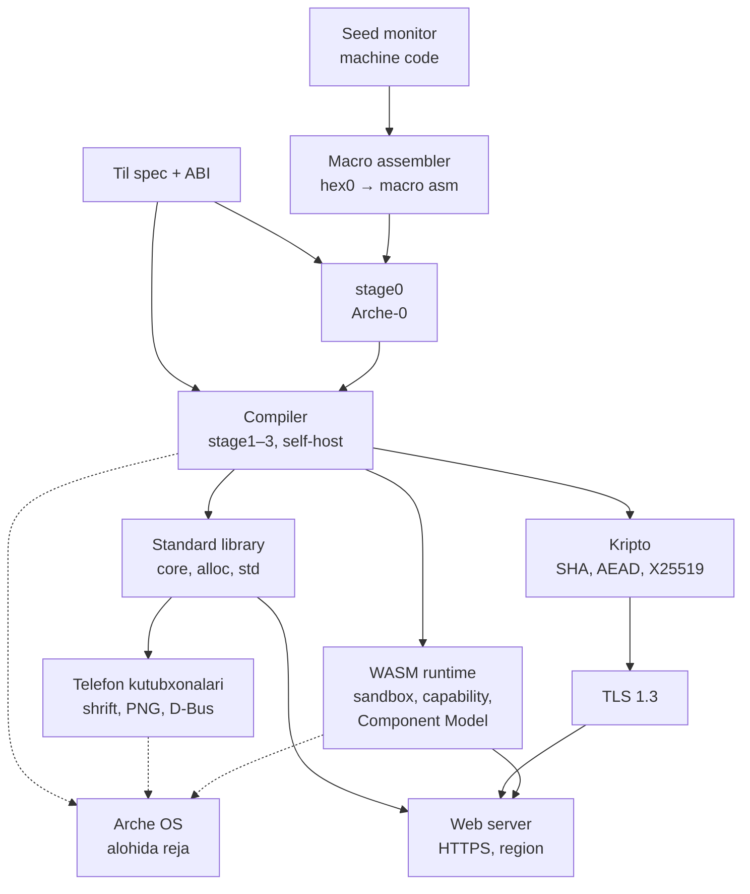

# Arche — til, compiler va kutubxonalar: to'liq reja

> 2026-11-05 holatidagi nusxa. Arche OS rejasi alohida: [arche-os/docs/plan.md](https://github.com/arche-family/arche-os/blob/main/docs/plan.md).

## Maqsad va doira

Yakuniy natija noldan qurilgan Arche tili: self-hosted compiler, toolchain, standard library va kutubxonalar (kripto, TLS, HTTP, web framework, WASM). Til Linux va Windows'da (keyinroq macOS'da) OS'siz to'liq ishlaydi.

**Arche OS alohida rejada.** Bu hujjat OS bilan faqat ABI (syscall interfeysi) va `freestanding` target orqali bog'langan. Kernel uchun tilga qo'yiladigan talablar spetsifikatsiya jadvalidagi "Past daraja" qatorida.

**Farazlar:** hardware va uning ROM firmware'i bor (boot sector'ni yuklay oladi). OS, compiler va C/C++/Rust/LLVM yo'q. Shu farazlarsiz real dunyo varianti "Real dunyoda ishga tushirish" bo'limida.

**Doiraga kiradi:**

- Bootstrap zanjiri: machine code → macro assembler → stage0 → self-hosted compiler
- Til spetsifikatsiyasi, compiler, ABI, toolchain, package manager
- Standard library (`core`, `alloc`, `std`) va uning backend'lari
- Kutubxonalar: kripto, TLS 1.3, HTTP/1.1 va HTTP/2, web framework, WASM backend va runtime

**Doiradan tashqarida:** Arche OS (alohida reja), brauzer, GUI toolkit. UI server Arche OS rejasida; bu rejada faqat u tayanadigan kutubxonalar bor ("Arche OS telefoni uchun kutubxonalar" bo'limi).

**Yakuniy qabul mezoni:** bootstrap'da stage2 va stage3 bit-identical chiqadi. Compiler va std testlari barcha target'larda o'tadi. Linux'da Arche'da yozilgan web server HTTPS so'rovga javob beradi.

## Dizayn tamoyillari

Arche'ning bosh mezoni: kodning ma'nosini butun loyihani o'qimasdan, faylning o'zidan to'g'ri tushunish mumkin bo'lsin. Inson ham, AI agent ham kodni qisman o'qiydi. Shuning uchun quyidagi har bir qoida shu mezonga xizmat qiladi va aniq bir xato turini yo'qotadi.

| Tamoyil | Til qoidasi | Yo'qotadigan xato |
| --- | --- | --- |
| Har nomning manbai ko'rinadi | glob import, shadowing, function overloading va operator overloading yo'q | mavjud bo'lmagan yoki boshqa narsani bildiradigan nomni chaqirish |
| Signature to'liq shartnoma | capability'lar, allocator, error set (public API'da aniq yoziladi) va `nopanic` imzoning o'zida | funksiya ichida kutilmagan I/O, allocation yoki panic |
| Yashirin narsa yo'q | implicit conversion, exception va yashirin allocation yo'q; `defer` yagona keyinga qoldirish mexanizmi | ko'rinmas xarajat va kutilmagan control flow |
| Chaqiruvda aniqlik | bir xil turdagi ikki parametr bo'lsa, chaqiruvda label majburiy: `copy(from: a, to: b)` | argumentlarni almashtirib yuborish |
| Xato e'tibordan chetda qolmaydi | ishlatilmagan `!T` natija compile xatosi | jim yutib yuborilgan xatolar |
| Niyat kodda yoziladi | `requires` / `ensures` contract'lar; std'da property-based test | compile bo'ladigan, lekin noto'g'ri ishlaydigan kod |
| Determinizm | map tartibi = qo'shilish tartibi; seed'li random va test scheduler; reproducible build | flaky test va takrorlanmaydigan bug |
| Bitta yo'l | sozlamasiz format, bitta generics mexanizmi (comptime), spec 60 sahifadan oshmaydi | uslublar to'qnashuvi, tilni to'liq bilmaslik |
| Tahrirga qulay sintaksis | trailing comma hamma joyda, har blok `{}`, significant whitespace yo'q, har import alohida qatorda | avtomatik tahrir va diff'dagi xatolar |
| Compiler muloqot sherigi | JSON diagnostika, avtomatik qo'llanadigan fix, barqaror xato kodlari, `arche query` | xato xabarini noto'g'ri talqin qilish, loyihada adashish |
| Buzmasdan rivojlanish | har paketda `edition`; `arche fix --edition` kodni ko'chiradi | til yangilanganda eski kodning sinishi |

## Bog'liqliklar xaritasi

Bootstrap zanjiri qat'iy ketma-ket boradi. Compiler self-host bo'lgach standard library, kripto, WASM runtime va alohida rejadagi Arche OS bir vaqtda yoziladi. Web server std, TLS va WASM runtime ustiga quriladi.

## Bootstrap zanjiri

Bootstrap bo'sh mashinadan self-hosted compiler'gacha yetkazadi. Uning yakuniy sinovi: stage2 va stage3 bit-identical bo'lishi kerak.

1. **Seed monitor** (machine code, taxminan 1–2 KB). Boot sector'dan yuklanadi. Konsoldan hex o'qib xotiraga yozadi, disk sektorlarini o'qiydi va yozadi, berilgan manzilga jump qiladi. Bootstrap davridagi yagona "OS" shu.
2. **hex0 → macro assembler.** Avval hex'da label'siz minimal assembler yoziladi. U bilan label va macro'li assembler quriladi (taxminan 1,5k qator). Qabul: macro assembler o'zini assemble qiladi va o'sha binary'ni chiqaradi.
3. **Bootstrap fayl tizimi.** Monitor'ga eng oddiy flat FS qo'shiladi (fayl nomi → sektorlar ro'yxati). Source va output'lar shu yerda fayl sifatida turadi.
4. **stage0 compiler** (macro assembly, taxminan 5–8k qator). Arche-0 subset'ini assembly text'ga compile qiladi. Codegen stack-machine usulida, optimizatsiya yo'q, type check minimal, xato xabari fayl va qator raqamidan iborat. Qabul: stage1 source'ini compile qiladi.
5. **stage1** to'liq compiler source'i bo'lib, Arche-0'da yozilgan va stage0 bilan compile qilinadi. Binary sekin, lekin to'g'ri kod chiqaradi.
6. **stage2** o'sha source'ni stage1 bilan compile qilishdan chiqadi. Bu optimizatsiyalangan, tez binary.
7. **stage3** o'sha source'ni stage2 bilan compile qilishdan chiqadi. **stage2 == stage3 bit-identical** bo'lishi majburiy qabul mezoni.

**Arche-0 subset** to'liq [`spec/arche-0.md`](../spec/arche-0.md)'da belgilangan: module va import, `const`, `struct`, payload'li `enum`, error set'lar, method'lar, butun sonlar, `bool`, `str`, array'lar, `?T` va `E!T`, `if`/`while`/`match`/`defer`, `try`/`catch`/`orelse`. View turlar (`&T`, `&mut T`, `[]T`, `str`) faqat parametr va lokal o'zgaruvchilarda ishlatiladi. Generic tur e'lon qilish, comptime, region, interface, closure va raw pointer yo'q; `List`, `Map`, `String` va `Interner` kabi tayyor turlarni faqat ishlatish mumkin.

**Qoida:** compiler source'i doim Arche-0 subset'ida qoladi. Tilning to'liq imkoniyatlari std, kernel va boshqa kodda ishlatiladi. Shunda bootstrap'ni istalgan vaqtda stage0'dan qayta o'tkazish mumkin bo'ladi. stage0 muzlatiladi va faqat shu tekshiruv uchun saqlanadi.

## Til spetsifikatsiyasi

Spetsifikatsiya compiler'dan oldin yoziladi va conformance test suite bilan birga yuradi. Har qoidaga kamida bitta ijobiy va bitta salbiy test to'g'ri keladi.

| Soha | Qaror |
| --- | --- |
| Sintaksis | LL(1) grammar, `name: Type`, header yo'q, module = fayl, har blok `{}`, trailing comma hamma joyda |
| Nomlar | glob import, shadowing, function overloading va operator overloading yo'q; hamma narsa default private, `pub` aniq yoziladi |
| Primitive'lar | `i8..i64`, `u8..u64`, `f32`, `f64`, `bool`, `str` (UTF-8 slice) |
| Composite | `struct`, payload'li `enum`, slice `[]T`, array `[N]T`, `?T`, `!T` |
| Xotira | value semantics (move/copy), second-class reference `&T` / `&mut T`, `region`, `unsafe` + `*T` |
| Allocator | interface sifatida aniq uzatiladi, global allocator yo'q |
| Xatolar | error union `!T`, `try`, `catch`, `orelse`, return trace; public API'da error set aniq yoziladi; ishlatilmagan `!T` compile xatosi; panic faqat bug uchun, `nopanic` belgisi bilan |
| Arifmetika | overflow trap, `+%` wrapping, saturating uchun alohida funksiyalar; bounds check doim yoqiq |
| Chaqiruv | bir xil turdagi ikki parametr bo'lsa, chaqiruvda label majburiy |
| Contract'lar | `requires` / `ensures`: debug'da tekshiriladi, comptime isbotlaganlari release'da olib tashlanadi |
| Generics | `comptime` parametrlar + `where` constraint'lar (interface orqali) |
| Polimorfizm | interface, inheritance yo'q, dynamic dispatch `dyn I` orqali |
| Capability | `Fs`, `Net`, `Clock`, `Env`, `Proc` faqat parametr orqali keladi; global I/O yo'q |
| Concurrency | structured scope, task'lar orasida move, shared state faqat `Shared(T)`; async/await yo'q |
| Determinizm | map iteration = qo'shilish tartibi; seed'li random; testlar uchun seed'li scheduler |
| Evolyutsiya | har paketda `edition`; eski kod o'z edition qoidalari bilan compile bo'laveradi |
| Undefined behavior | faqat `unsafe` ichida bo'lishi mumkin |
| Past daraja | `asm` blok, `naked` funksiyalar, `volatile` o'qish/yozish, atomic'lar va memory ordering, `packed` va `align(N)`, section nazorati, `freestanding` target (x86-64, RISC-V 64 va ARM64); hammasi `unsafe` ichida (kernel talablari OS rejasida) |

**Deliverable'lar:**

- `spec/`: grammar (EBNF) va semantika
- `conformance/`: test suite (taxminan 2–3k test)
- Memory model qoidalari (reference qochishi, region chegarasi, move'dan keyin foydalanish), har biri o'z compiler xato kodi bilan

## Compiler

Compiler bitta `arche` binary'si sifatida chiqadi, hajmi taxminan 60–100k qator. Pipeline: source → CST → typed AST → SSA IR → target kod.

| Komponent | Vazifa | Qabul mezoni |
| --- | --- | --- |
| Lexer + parser | LL(1), error recovery, lossless CST (formatter ham shundan foydalanadi) | conformance syntax testlari; fuzz 24 soat crash'siz |
| Name resolution | module'lar, import, scope, visibility | barcha resolution testlari |
| Type checker | lokal type inference, interface constraint'lar | conformance type testlari |
| Comptime interpreter | IR ustida ishlaydi, sandbox: I/O yo'q, qadamlar soni cheklangan | generics va comptime testlari |
| Memory checker | move, second-class reference, region escape, `unsafe` chegarasi | barcha memory model testlari, har xato o'z kodi bilan |
| Lowering | typed AST → SSA IR | IR verifier har pass'dan keyin o'tadi |
| Optimizatsiya | inlining, SCCP, DCE, GVN, LICM, bounds-check elimination | benchmark'larda regressiya yo'q |
| Register allocation | linear scan | stage2 == stage3 |
| Backend'lar | x86-64, ARM64, RISC-V 64, WASM | har target'da cross-build stage2 == stage3 |
| Assembler + linker | o'z object format'i, static linking | tashqi tool'siz executable chiqadi |
| Debug info | source map, stack trace, DWARF | panic'da fayl:qator chiqadi; `gdb`'da breakpoint va lokal o'zgaruvchilar ishlaydi |
| Diagnostika | xato kodi, aniq joy, avtomatik qo'llanadigan fix; matn va JSON formatda | har xato kodi uchun misol test |

**Rejimlar:** debug build IR'dan to'g'ridan-to'g'ri, minimal optimizatsiya bilan kod chiqaradi. Release build barcha pass'larni ishlatadi. Incremental compilation module darajasida, content-hash cache bilan ishlaydi.

## ABI va object format

ABI birinchi kundanoq stabil va hujjatlashtirilgan bo'ladi. C yo'q dunyoda keyin paydo bo'ladigan barcha tillar uchun umumiy interfeys aynan shu ABI bo'ladi.

- **Calling convention** har target uchun alohida yoziladi: argument register'lari, callee-saved'lar, stack alignment 16. Slice va `!T` kabi ko'p qiymatlar register'larda qaytariladi.
- **Layout'lar:** slice = `{ptr, len}`; `?T` pointer'da niche (null), boshqa turlarda `{tag, T}`; `!T` = `{error_code: u16, T}`; enum = `{tag, union}`, tag hajmi minimal.
- **Symbol naming:** `module.path.fn` ko'rinishidagi deterministik mangling.
- **Object format (`.ao`):** code, data, rodata, bss, relocation, symbol va debug section'lari. Relocation turlari har target uchun belgilangan.
- **Executable format:** oddiy header + segment'lar. Kernel loader va bootstrap monitor ikkalasi ham shu format'ni o'qiydi.
- **Syscall ABI:** capability handle (`u32`) + operatsiya kodi + argumentlar register'larda. Xato `!T` layout'ida qaytadi.
- **Versiyalash:** ABI versiyasi object header'ida turadi. Uni o'zgartirish faqat major release'da mumkin.

Qabul: ABI hujjati + har target uchun ABI test suite. Unda boshqa modulda compile qilingan funksiyalar har bir layout bilan o'zaro chaqiriladi.

## Toolchain va package manager

Vositalar `arche` binary'sida jamlanadi. Compiler Arche-0'da qolgani uchun (process ishga tushirolmaydi, stdin va tarmoq yo'q) bularga muhtoj vositalar ikkinchi dasturda, to'liq Arche'da: `arche-driver` va `arche-lsp`. Build tizimi, formatter yoki package manager uchun alohida til ishlatilmaydi.

| Buyruq | Vazifa |
| --- | --- |
| `arche-driver build` | build fayli `build.arche` Arche'ning o'zida yoziladi; incremental, content-hash cache bilan |
| `arche-driver run` | build qilib ishga tushiradi |
| `arche test` | `test` bloklarini parallel ishga tushiradi, filter bor; seed har doim chiqariladi |
| `arche check --json` | diagnostikani JSON'da beradi: xato kodi, joy, avtomatik qo'llanadigan fix (edit sifatida) |
| `arche fix` | fix'larni qo'llaydi; `--edition` bilan kodni yangi edition'ga ko'chiradi |
| `arche query` | definition, reference, type va caller'larni so'raydi; `arche-lsp` ham shunga tayanadi |
| `arche complete` | berilgan joyda mumkin bo'lgan nomlar, field'lar va method'lar |
| `arche explain` | xato kodini misol bilan tushuntiradi |
| `arche fmt` | yagona format, sozlamalarsiz |
| `arche doc` | doc comment'lardan Markdown chiqaradi; doc'dagi misollar test sifatida ishga tushadi |
| `arche-driver pkg` | dependency qo'shadi, lock qiladi, vendor qiladi |
| `arche-lsp` | editor'lar uchun LSP server |

**Package manager:**

- Manifest'da paketga kerak bo'lgan capability'lar e'lon qilinadi (`needs: [Net]`). Manifest'da yo'q capability turini paket ichida ishlatishga compiler ruxsat bermaydi.
- Lockfile'da har dependency content hash bilan qayd etiladi.
- Registry content-addressed bo'ladi: versiyalar o'zgarmas va Ed25519 bilan imzolangan.
- Reproducible build kafolatlanadi: bir xil source va lockfile har doim bit-identical output beradi.

**Editor integratsiyasi:**

- `arche-lsp` har so'rovda compiler'ni alohida process'da ishga tushiradi. Compiler butun ishini bitta arena'da qiladi va xotirani bo'shatmaydi, shuning uchun uzoq yashaydigan server uning ichida bo'la olmaydi.
- Compiler saqlanmagan matnni qabul qiladi, shuning uchun xato yozish paytida ko'rinadi. Rang berish uchun TextMate grammatikasi bor.

## Standard library

Standard library uch qatlamdan iborat, har biri pastdagisiga tayanadi. Kernel faqat `core` va `alloc` bilan ishlaydi.

| Qatlam | Tarkibi | Kim ishlatadi |
| --- | --- | --- |
| `core` | primitive op'lar, slice, `?T` / `!T` helper'lari, interface'lar (Eq, Ord, Hash, Iter), allocator'siz fmt, math, UTF-8 | hamma, kernel ham |
| `alloc` | Allocator interface; page, arena, pool va general allocator'lar; region runtime; List, Map, Set, String, Interner | kernel va userland |
| `std` | capability turlari (Fs, Net, Clock, Env, Proc), fayl, process, task/scope, channel, `Shared(T)`, time, path, JSON, test runner | userland |

**Platformalar:** `std` uch backend'ga ega: bootstrap monitor (gipotetik rejada; faqat Fs va konsol), host (Linux, Windows, keyinroq macOS) va Arche OS (OS rejasidagi syscall API ustida).

**Linux backend'idagi qo'shimchalar** (Arche OS telefonining Trek A'si uchun: Linux kernel ustida Arche userspace): DRM/KMS dumb buffer (ekranga chizish), evdev (touch va tugmalar) va `init` sifatida ishlash (PID 1: bola process'larni yig'ish, signal'lar). Ular `std.linux`'da, capability turlari orqali beriladi.

Qabul: `core` freestanding holda build bo'ladi (OS'siz, allocator'siz). `std` testlari barcha backend'larda ham o'tadi.

## Kripto, TLS va HTTP

Bu kutubxonalar OS'ga bog'liq emas: ular `std`'dagi `Net` capability ustida ishlaydi va host'da ham, Arche OS'da ham bir xil. TCP/IP stack'ning o'zi OS rejasida.

- **`crypto`:** SHA-256/384, HMAC, HKDF, ChaCha20-Poly1305, AES-GCM, X25519, Ed25519, ECDSA P-256 va CSPRNG. Kod constant-time yoziladi.
- **TLS 1.3:** client va server, X.509 sertifikatni parse qilish va zanjirni tekshirish.
- **HTTP:** HTTP/1.1 (keep-alive, chunked) va HTTP/2 (HPACK, stream multiplexing).

Qabul: kripto standart test vector'lardan o'tadi. TLS va HTTP mavjud implementatsiyalar bilan interop testlaridan o'tadi (gipotetik rejada o'z client/server juftligi bilan).

## Web server, framework va WASM

Web server har request'ni o'z region'ida bajaradi. Handler ichidagi barcha allocation'lar javob yuborilgach bitta operatsiya bilan bo'shatiladi.

**Server (`web`):**

- Har CPU'ga bitta worker; connection'lar task sifatida structured scope ichida ishlaydi.
- Request lifecycle: accept → region ochiladi → parse → routing → handler → response → region yopiladi.
- Router (path parametrlari, method'lar), middleware zanjiri, static fayllar, gzip.
- JSON encode/decode struct'lardan comptime orqali avtomatik hosil bo'ladi; template'lar ham comptime'da compile qilinadi.
- Storage: embedded KV store (B-tree + WAL). To'liq DB server alohida loyiha.

**WASM:**

- Backend: Arche → WASM. Bootstrap bo'limidagi stack codegen g'oyasi bu yerda deyarli 1:1 tushadi.
- Runtime: WASM runtime host'da ham, Arche OS'da ham ishlaydi (interpreter va baseline JIT).
- Host interfeys: capability'lar WASM import sifatida beriladi, modul faqat o'ziga berilgan import'larga kira oladi.
- **Component Model:** WIT bilan tasvirlangan interfeyslar va canonical ABI (string, list, record, variant, option, result). Arche OS ilova modeli [Nimadir](https://github.com/Nodirbek-Abdulaxadov/nimadir) kontraktiga quriladi, shuning uchun Nimadir uchun Rust, C# yoki Python'da yozilgan component'lar Arche runtime'ida qayta build qilinmasdan ishlashi kerak.
- **Resurs chegaralari:** har chaqiruvga vaqt deadline'i (epoch uslubida: kompilyatsiya qilingan kod sikl va funksiya boshida hisoblagichni tekshiradi) va linear memory uchun yuqori chegara. Chegaradan oshgan modul to'xtatiladi va host qaysi chegara ekanini biladi.
- Server handler'larni WASM modul sifatida sandbox'da yuklay oladi.

Qabul: Nimadir'ning `counter`, `hello` va `store` component'lari Arche runtime'ida ishlaydi, `runaway` component'i vaqt va xotira chegarasida to'xtatiladi. Linux'da web server HTTPS (TLS 1.3, HTTP/2) orqali static fayl va JSON API javoblarini beradi. WASM modul handler sifatida ishlaydi. Throughput va p99 latency o'lchanib, regressiya testlari uchun baseline qilib qo'yiladi.

## Arche OS telefoni uchun kutubxonalar

Arche OS'ning birinchi mahsuloti telefon (OS rejasidagi "Mahsulot yo'nalishi" va "Telefon: ikki trek" bo'limlari). Uning UI server'i va tizim xizmatlari quyidagi kutubxonalarga tayanadi. Ular OS'ga bog'liq emas va host'da ham ishlaydi, shuning uchun til rejasida turadi.

- **Shrift:** TrueType parse va rasterizer (antialiasing bilan), glyph cache. Lotin va kirill (o'zbek tilining ikkala yozuvi, rus); murakkab skriptlar keyinroq.
- **Rasm:** PNG decoder (deflate bilan); keyin JPEG.
- **D-Bus client:** message format, autentifikatsiya, method call va signal'lar. Trek A'da ModemManager, iwd va PipeWire bilan gaplashish uchun; Trek B'da kerak emas.
- **Fuzzing:** shrift, PNG va D-Bus parser'lari boshidan fuzz qilinadi: ular tashqi ma'lumotni o'qiydi.

Qabul: shrift rasterizer'i bir xil matnni har platformada bit-identical chizadi (golden image testlari). PNG decoder PngSuite'dan o'tadi. D-Bus client Linux'dagi `dbus-daemon` bilan interop qiladi va ModemManager'dan modem ro'yxatini oladi.

## Test va sifat

Har komponent birinchi qatoridanoq test bilan yoziladi. Bootstrap va reproducibility tekshiruvlari esa release'ni bloklovchi shart hisoblanadi.

| Tekshiruv | Nima | Qachon |
| --- | --- | --- |
| Bootstrap | stage0 → stage1 → stage2 → stage3, stage2 == stage3 | har release |
| Reproducibility | ikki xil mashinada build → bit-identical | har release |
| Conformance | til spetsifikatsiyasi testlari | har commit |
| Differential | bir dastur stage1 va stage2 bilan compile qilinadi → natija bir xil bo'lishi kerak | har kuni |
| Fuzzing | parser, type checker, memory checker, comptime, TLS, HTTP parser | doimiy |
| Kripto | standart test vector'lar + constant-time tekshiruvi | har commit |
| Benchmark | compile tezligi, web throughput | har release, regressiya ogohlantirishi bilan |

## Real dunyoda ishga tushirish

Bugun bu reja bajarilsa, faqat bootstrap va infratuzilma qismlari mavjud vositalarga almashadi. Til, ABI, compiler arxitekturasi va kutubxonalar o'zgarmaydi.

| Gipotetik reja | Real dunyo |
| --- | --- |
| Seed monitor + macro assembler | kerak emas: Linux yoki Windows host |
| stage0 assembly'da | stage0 C11'da (taxminan 5–8k qator): Arche-0'ni C'ga tarjima qiladi, natijani gcc, clang yoki tcc build qiladi; C'ning hex0'dan boshlanadigan to'liq bootstrap zanjiri Arche'ga ham o'tadi |
| `std` monitor backend'i | `std` host backend'i (Linux syscall'lari) |
| O'z release backend'i | o'z IR → LLVM textual `.ll` → `clang` / `llc`; debug va WASM uchun o'z backend'i |
| O'z linker'i, `.ao` format | host'da ELF/PE + `lld`; Arche OS ichida o'z format'i |
| O'z client/server juftligi bilan interop | OpenSSL, curl va brauzerlar bilan interop testlari |

Self-hosting qoidasi o'zgarmaydi: stage1 Arche-0'da yoziladi va stage2 == stage3 talab qilinadi. Mavjud tildagi stage0 faqat bootstrap uchun saqlanadi. LLVM'ga frontend emas, faqat IR'dan `.ll` chiqaradigan backend ulanadi, shuning uchun uni keyin almashtirish frontend'ga tegmaydi.

## Qarorlar va risklar

Eng katta risk hajmda: til tomoni taxminan 125–205k qator (OS'siz). Quyidagi qarorlarning har biri soddalik uchun nimadandir voz kechadi.

| Masala | Qaror | Risk / muqobil |
| --- | --- | --- |
| Compiler source'i Arche-0'da | bootstrap doim stage0'dan o'tadi | compiler kodi noqulayroq bo'ladi; muqobil "oldingi release compile qila oladi" qoidasi, lekin unda bootstrap zanjiri har release'da uzayadi |
| Second-class reference | lifetime annotation'siz xavfsizlik | graph va linked list noqulay bo'ladi → arena + handle; ba'zi kutubxonalarda `unsafe` ko'payishi mumkin |
| GC yo'q | kernel'dan web'gacha bitta memory model | UI ham arena + handle bilan yoziladi, GC'li yordamchi til bo'lmaydi; bu noqulaylik ongli ravishda qabul qilinadi |
| Comptime | generics, macro va build bitta mexanizmda | suiiste'mol qilinsa compile sekinlashadi → comptime qadam limiti va profiler |
| Hajm | spec va conformance test birinchi yoziladi | spec va testlar tayyor bo'lsa, boshqalar komponentlarni parallel yoza oladi |
| Arche OS telefoni | ARM64 `freestanding`, Component Model va telefon kutubxonalari til rejasiga qo'shildi | ish hajmi oshadi; Trek A uchun kerakli qismlar (Component Model, D-Bus, shrift) web server'dan oldin bajarilishi mumkin, ular faqat `std`'ga tayanadi |
| Editor integratsiyasi | `arche-lsp` va DWARF rejaga qo'shildi; LSP compiler ichida emas, alohida dasturda | ish hajmi oshadi; har so'rovda yangi process katta paketlarda sekinlashishi mumkin |
