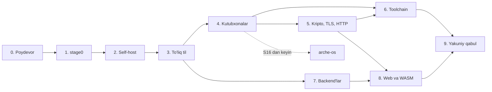

# Arche tili — sprintlar

> 2026-11-03 holati. Asos: [plan.md](plan.md) va [spec/arche-0.md](../spec/arche-0.md). Bootstrap "Real dunyoda ishga tushirish" variantida: stage0 C11'da, release backend LLVM `.ll` orqali. Arche OS sprintlari bu yerda yo'q.

**Joriy sprint:** S0: ishlar bajarilgan, qabul uchun CI'ning GitHub'da yashil bo'lishi kutilmoqda.

## Qoidalar

- Sprint sana bilan emas, qabul mezoni bilan yopiladi. Qabul mezoni CI'da avtomatik tekshiriladi.
- Til imkoniyati bitta sprintda uch qism bilan birga keladi: spec matni, conformance testlari va implementatsiya. Har qoidaga kamida bitta ijobiy va bitta salbiy test to'g'ri keladi.
- Compiler source'i doim Arche-0'da qoladi. S9'dan boshlab har sprint to'liq bootstrap va stage2 == stage3 tekshiruvi bilan yopiladi.
- S5'dan boshlab har yangi xato kodi `arche explain` uchun misol va test bilan qo'shiladi.
- Fuzzing komponent paydo bo'lgan sprintda boshlanadi va keyin doimiy ishlaydi.
- Sprint rejadagi qarorni o'zgartirsa, `plan.md` va spec shu sprintning o'zida yangilanadi.

## Umumiy ko'rinish

| Bosqich | Sprintlar | Natija |
| --- | --- | --- |
| 0. Poydevor | S0 | test format'i, runner, CI |
| 1. stage0 | S1–S4 | Arche-0 → C tarjimon |
| 2. Self-host | S5–S9 | Arche-0'da yozilgan compiler, stage2 == stage3 |
| 3. To'liq til | S10–S14 | to'liq spec, compiler'da til imkoniyatlari |
| 4. Kutubxonalar | S15–S19 | `core`, `alloc`, `std` (Linux, Windows), `freestanding` |
| 5. Kripto, TLS, HTTP | S20–S22 | OS'ga bog'liq bo'lmagan tarmoq kutubxonalari |
| 6. Toolchain | S23–S25 | `arche` buyruqlari, build tizimi, package manager |
| 7. Backend'lar | S26–S30 | optimizatsiya, o'z backend'lari, linker, WASM |
| 8. Web va WASM | S31–S33 | WASM runtime, web server |
| 9. Yakuniy qabul | S34 | rejaning yakuniy qabul mezoni |

Bosqichlar raqam tartibida yoziladi. Bir nechta ishchi bo'lsa, grafikdagi parallel tarmoqlar bir vaqtda olib borilishi mumkin.

## 0. Poydevor

### S0. Infratuzilma

- `stage0/`: C11 loyiha skeleti va Makefile. gcc va clang bilan `-std=c11 -Wall -Wextra -Werror` ostida build bo'ladi.
- `conformance/` va test format'i. Har test bitta `.arche` fayl bo'ladi. Kutilgan natija fayl boshidagi izohlarda yoziladi: stdout, exit kodi yoki compile xato kodi. §12'dagi tekshiruvlarning salbiy testlari "stage0 o'tkazib yuborishi mumkin" deb belgilanadi.
- Test runner C11'da yoziladi, chunki u Arche paydo bo'lguncha ishlashi kerak. Keyin uni `arche test` almashtiradi.
- CI (GitHub Actions, Linux): har commit'da stage0 build va conformance testlari ishlaydi.
- Hujjatlardagi ma'lum nomuvofiqliklar tuzatiladi:
  - `plan.md`'dagi `Shared<T>` → `Shared(T)`.
  - `plan.md`'dagi `alloc` qatoridagi `StringBuilder` §11'dagi `alloc.String` bilan moslashtiriladi.
  - §7.4'dagi struct literal cheklovi §14'dagi "grammar ifodalamaydigan cheklovlar" ro'yxatiga qo'shiladi.

**Qabul:** CI yashil. Runner namunaviy ijobiy va salbiy testlarni to'g'ri baholaydi.

## 1. stage0 (C11, Arche-0 → C)

Bosqich natijasi: stage0 spec'dagi Arche-0'ni to'liq qabul qiladi va stage1 source'ini compile qilishga tayyor bo'ladi.

### S1. Boshidan oxirigacha ishlaydigan eng kichik dastur

- Lexer §2 bo'yicha to'liq: barcha token'lar, literal'lar, escape'lar, `as%`, doc comment'lar, string tashqarisidagi `\r` xatosi.
- Parser eng kichik qism uchun: `import`, `fn`, method chaqiruvi, string literal, `return`.
- C emitter va runtime: `std.System`, `Output`, `Args`. Chiqishda `Output` flush qilinadi.
- `panic` built-in'i: `panic: <xabar>` source joyi bilan chiqadi va status 101.

**Qabul:** `sys.stdout.write("hello\n")` dasturi gcc va clang bilan build bo'lib ishlaydi. Lexer conformance testlari o'tadi.

### S2. Ifodalar va boshqaruv

- §14'dagi to'liq grammar uchun parser. Xato xabari fayl va qator raqamidan iborat.
- Butun son turlari, literal turi kontekstdan (§5.6), `const`, `let`/`var`, compound assignment.
- Arifmetika (§7.2): nolga bo'lish, shift kengligi va `as` trap'lari, `as%`. Precedence (§7.1) va hisoblash tartibi (§7.3).
- `if`, step'li `while`, `break`/`continue`, barcha chiqish yo'llarida `defer`, funksiyalar, rekursiya, `assert`, `unreachable`.

**Qabul:** §7 va §8 conformance testlari, trap testlari bilan birga, o'tadi.

### S3. Turlar, match va modullar

- `struct` (method'lar, associated funksiyalar, `self` turlari), payload'li `enum`, error set'lar (global error nomlari), `[N]T`, alias.
- View'lar: `&T`, `&mut T`, `[]T`, `str`. Indekslash va slicing bounds trap'i va UTF-8 chegarasi trap'i bilan.
- `match` (§9): barcha pattern'lar, copy va move bilan binding, hech biri mos kelmasa trap.
- Modullar (§3): ko'p fayl, `import … as`, import cycle'lar; dastur butunligicha compile qilinadi.
- `==` va `!=` (§5.5), struct'larda field bo'yicha.

**Qabul:** §15'dagi `Ast` misoli va ko'p modulli dastur ishlaydi. §3, §5 va §9 conformance testlari o'tadi.

### S4. Optional, xatolar va kutubxona

- `?T`, `E!T`, `try`, `catch`, `orelse`, return lifting, `some`/`none`/`ok`/`err` pattern'lari. `try` xato bilan chiqqanda ham `defer` ishlaydi.
- `main` xato qaytarsa, `error: Name` chiqadi va status 1.
- §11 runtime'i to'liq: `List`, `Map` (qo'shilish tartibida), `String`, `Interner`, `Fs.read_file`/`write_file`, `str` method'lari.

**Qabul:** §15'dagi `lines` dasturi ishlaydi. stage0 o'tkazib yuborishi mumkin deb belgilanmagan barcha conformance testlari o'tadi.

## 2. Self-host (compiler Arche-0'da)

Bosqich natijasi: `compiler/` Arche-0'da yozilgan va o'zini build qiladi. Pipeline: source → CST → typed AST → SSA IR → `.ll`.

### S5. Frontend

- Lexer, LL(1) parser, error recovery, lossless CST.
- Diagnostika infratuzilmasi: barqaror xato kodlari, aniq joy, matn va JSON format, fix'lar edit sifatida.
- Parser fuzzing boshlanadi.

**Qabul:** compiler stage0 bilan build bo'ladi. CST'dan source bayt-ba-bayt tiklanadi: compiler'ning o'z source'i va barcha conformance fayllari uchun. Syntax testlari to'g'ri xato kodlari bilan o'tadi. Parser 24 soat fuzz qilinganda crash bo'lmaydi.

### S6. Nomlar va turlar

- Name resolution: modullar, import, scope, visibility.
- Arche-0 uchun type checker: lokal type inference, literal konteksti.
- §12'dagi barcha erasable tekshiruvlar, har biri o'z xato kodi bilan.

**Qabul:** Arche-0'ning barcha conformance testlari, salbiylari ham, to'g'ri xato kodi bilan o'tadi.

### S7. Memory checker

- §5.4: view qayerda turishi mumkinligi, projection, path bo'yicha exclusivity.
- §5.5: move'dan keyin foydalanish, `match`'dagi move.
- Har qoida o'z xato kodi bilan. Memory checker fuzzing boshlanadi.

**Qabul:** memory model testlari o'tadi. Compiler'ning o'z source'i memory checker'dan xatosiz o'tadi.

### S8. SSA IR va LLVM backend

- Typed AST → SSA IR lowering. Har pass'dan keyin IR verifier ishlaydi.
- IR → LLVM textual `.ll` (x86-64 Linux), executable'ni `clang` build qiladi.
- Arche-0 built-in turlari (`List`, `Map`, `String`, `Interner`) va §11'dagi `std` qismi compiler intrinsic'lari sifatida IR'ga tushiriladi. Host bilan aloqa libc'siz, to'g'ridan-to'g'ri Linux syscall'lari orqali bo'ladi.
- ABI hujjati v0: layout'lar (slice, `?T`, `E!T`, enum) va symbol mangling.
- Panic'da fayl va qator chiqadi.

**Qabul:** differential test: Arche-0 dasturlari stage0 orqali ham, yangi backend orqali ham bir xil natija beradi. Barcha run-time conformance testlari o'tadi.

### S9. Self-host

- Bootstrap skripti: stage0 → stage1 → stage2 → stage3.
- Output deterministik bo'ladi: unga vaqt, absolyut yo'llar va hash tartibi ta'sir qilmaydi.
- CI'da bootstrap har commit'da, differential test (stage1 va stage2) har kuni ishlaydi.
- stage0 muzlatiladi (git tag) va bundan keyin faqat bootstrap tekshiruvi uchun saqlanadi.

**Qabul:** toza Linux mashinada, faqat C compiler va LLVM bilan, bootstrap o'tadi va stage2 == stage3 bit-identical chiqadi.

## 3. To'liq til

Bosqich natijasi: to'liq spec bor va compiler concurrency hamda past darajadan tashqari barcha til imkoniyatlarini qo'llaydi. Compiler source'i Arche-0'da qoladi.

### S10. To'liq til spec'i

- `spec/` tuzilishi va to'liq tilning EBNF grammar'i.
- Arche-0'da yo'q imkoniyatlar bo'yicha ochiq qarorlar yopiladi: generic sintaksisi, closure'lar va ularning capture qoidalari, `for` va iterator protokoli, `if`/`match` ifoda sifatida, float semantikasi, `region` sintaksisi, `Shared(T)`.
- Memory model to'liq yoziladi: reference qochishi, region chegarasi, move'dan keyin foydalanish. Har qoidaga xato kodi biriktiriladi.

**Qabul:** spec 60 sahifadan oshmaydi. Arche-0'ning har qoidasi to'liq spec'da o'zgarishsiz turadi (strict subset).

### S11. Comptime va generics

- Comptime interpreter IR ustida ishlaydi: sandbox, I/O yo'q, qadamlar soni cheklangan.
- `comptime` parametrlar, generic tur va funksiyalar, monomorphization.
- Comptime profiler.

**Qabul:** generics va comptime conformance testlari o'tadi. Comptime fuzzing boshlanadi.

### S12. Interface'lar va iteratsiya

- `interface`, `where` constraint'lar, `dyn I` orqali dynamic dispatch.
- `for` sikli iterator protokoli orqali.

**Qabul:** interface, `where`, `dyn` va `for` conformance testlari o'tadi.

### S13. Region, unsafe va closure'lar

- `region` va region escape tekshiruvi.
- `unsafe` blok va `*T` raw pointer. Undefined behavior faqat `unsafe` ichida bo'lishi mumkin.
- Closure'lar S10'da belgilangan capture qoidalari bilan.

**Qabul:** to'liq tilning memory model testlari o'tadi, har xato o'z kodi bilan.

### S14. Qolgan til imkoniyatlari

- `if` va `match` ifoda sifatida; labeled `break`/`continue`.
- `f32`, `f64`.
- `requires`/`ensures`: debug build'da tekshiriladi.
- `nopanic` belgisi va uning tekshiruvi; error return trace.

**Qabul:** S10 spec'ining concurrency va past darajadan tashqari barcha bo'limlari implementatsiya qilingan, ularning conformance testlari o'tadi.

## 4. Kutubxonalar

### S15. `core` va `alloc`

- `core`: primitive op'lar, slice, `?T`/`E!T` helper'lari, `Eq`, `Ord`, `Hash`, `Iter`, allocator'siz fmt, math, UTF-8.
- `alloc`: `Allocator` interface; page, arena, pool va general allocator'lar; region runtime; `List`, `Map`, `Set`, `String`, `Interner`.
- Compiler intrinsic'lari kutubxona bilan almashtiriladi: Arche-0 turlari endi `alloc`'dan keladi, signature'lari §11 bilan bir xil.

**Qabul:** `core` OS'siz va allocator'siz build bo'ladi. Intrinsic'larsiz bootstrap'da ham stage2 == stage3.

### S16. Past daraja va `freestanding`

- `asm` blok, `naked` funksiyalar, `volatile` o'qish/yozish, atomic'lar va memory ordering, memory barrier'lar.
- `packed`, `align(N)`, aniq field tartibi, section va link nazorati.
- Panic handler'ni almashtirish, target ISA tanlash.
- `freestanding` target: `std`'siz build.
- Bu imkoniyatlarning hammasi `unsafe` ichida ishlaydi.

**Qabul:** faqat `core` va `alloc` bilan build bo'lgan freestanding binary QEMU'da (x86-64 va RISC-V 64) ishga tushib serial'ga yozadi. Shundan keyin arche-os ishi boshlanishi mumkin.

### S17. `std`: Linux host

- Capability turlari: `Fs`, `Net`, `Clock`, `Env`, `Proc`. Fayl, process, time, path, JSON.
- Test runner: `test` bloklari, filter, har doim chiqariladigan seed. Property-based test, seed'li random.
- Linux backend libc'siz, syscall'lar orqali ishlaydi.

**Qabul:** `std` testlari Linux'da o'tadi. Compiler §11'dagi `std` qismini shu kutubxonadan oladi, bootstrap'da stage2 == stage3.

### S18. Concurrency

- Structured scope, task'lar, task'lar orasida move, channel, `Shared(T)`.
- Testlar uchun seed'li scheduler.

**Qabul:** concurrency conformance testlari o'tadi. Seed'li scheduler bir xil seed bilan bir xil tartibni takrorlaydi.

### S19. Windows

- Windows target: LLVM orqali PE, link uchun `lld-link`.
- `std`'ning Windows backend'i (Win32 API).

**Qabul:** compiler va `std` testlari Windows'da o'tadi, Windows'dagi bootstrap'da stage2 == stage3.

## 5. Kripto, TLS, HTTP

### S20. Kripto

- SHA-256/384, HMAC, HKDF, ChaCha20-Poly1305, AES-GCM, X25519, Ed25519, ECDSA P-256, CSPRNG.
- Kod constant-time yoziladi va bu tekshiriladi.

**Qabul:** standart test vector'lar o'tadi. Constant-time tekshiruvi CI'da har commit'da ishlaydi.

### S21. TLS 1.3

- Client va server, X.509 sertifikatni parse qilish va zanjirni tekshirish.

**Qabul:** OpenSSL va curl bilan interop testlari o'tadi. TLS fuzzing boshlanadi.

### S22. HTTP

- HTTP/1.1 (keep-alive, chunked) va HTTP/2 (HPACK, stream multiplexing).

**Qabul:** curl va brauzerlar bilan interop testlari o'tadi. HTTP parser fuzzing boshlanadi.

## 6. Toolchain

### S23. Diagnostika va navigatsiya buyruqlari

- `arche check --json`, `arche fix`, `arche explain`.
- `arche fmt`: lossless CST ustida, sozlamasiz.
- `arche query`: definition, reference, type va caller'lar.
- `arche doc`: doc'dagi misollar test sifatida ishga tushadi.
- `arche test`: parallel, filter bilan; S0'dagi C11 runner'ni almashtiradi.

**Qabul:** har xato kodi uchun `explain` misoli va testi bor. `arche fmt` compiler source'ida idempotent. `arche fix` qo'llangandan keyin `arche check` toza chiqadi.

### S24. Build tizimi va edition'lar

- `arche build` (`build.arche` Arche'ning o'zida), `arche run`.
- Module darajasidagi incremental compilation va content-hash (SHA-256) cache.
- Har paketda `edition`; `arche fix --edition` kodni ko'chiradi.

**Qabul:** cache bilan qayta build toza build bilan bit-identical chiqadi. Edition ko'chirish testlari o'tadi.

### S25. Package manager va registry

- `arche pkg`: dependency qo'shish, lock, vendor.
- Manifest'da `needs: [...]`. Manifest'da e'lon qilinmagan capability'ni paket ichida ishlatish compile xatosi.
- Lockfile'da har dependency content hash bilan qayd etiladi.
- Content-addressed registry: versiyalar o'zgarmas, Ed25519 bilan imzolangan, HTTPS orqali.

**Qabul:** `needs` buzilishining salbiy testi o'tadi. Imzosi yoki hash'i mos kelmagan paket rad etiladi. Bir xil source va lockfile bit-identical output beradi.

## 7. Backend'lar

### S26. Optimizatsiya

- Inlining, SCCP, DCE, GVN, LICM, bounds-check elimination.
- Comptime isbotlagan contract'lar release build'dan olib tashlanadi.

**Qabul:** compile tezligi va runtime benchmark'lari baseline sifatida qayd etiladi. Release rejimida stage2 == stage3.

### S27. O'z x86-64 backend'i

- Instruction selection va linear scan register allocation.
- Debug build IR'dan to'g'ridan-to'g'ri, LLVM'siz chiqadi.
- Debug info: source map, stack trace.
- Host'da ELF object, link `lld` bilan.

**Qabul:** compiler va `std` testlari o'z backend'i bilan o'tadi. O'z backend'i bilan ham stage2 == stage3.

### S28. ARM64 va RISC-V 64

- Ikkala target uchun o'z backend'i va LLVM orqali release.
- Har target'ning calling convention'i ABI hujjatiga yoziladi.

**Qabul:** cross-build'da har target'da stage2 == stage3. Testlar QEMU user-mode'da o'tadi.

### S29. O'z object format'i va linker

- `.ao` format: code, data, rodata, bss, relocation, symbol va debug section'lari; ABI versiyasi header'da.
- Executable format: Arche OS kernel loader shu format'ni o'qiydi.
- Static linker.
- ABI hujjati yakunlanadi, har target uchun ABI test suite yoziladi.

**Qabul:** LLVM va `lld`'siz executable chiqadi. ABI test suite har target'da o'tadi: boshqa modulda compile qilingan funksiyalar har bir layout bilan o'zaro chaqiriladi.

### S30. WASM backend

- Arche → WASM, stack codegen.

**Qabul:** compiler va `std` testlarining WASM'da ishlay oladigan qismi mavjud WASM runtime'da o'tadi.

## 8. Web va WASM

### S31. WASM runtime

- Interpreter, keyin baseline JIT.
- Host interfeys: capability'lar WASM import sifatida beriladi, modul faqat o'ziga berilgan import'larga kira oladi.

**Qabul:** WASM spec testsuite'i interpreter'da ham, JIT'da ham o'tadi. Berilmagan import'ga murojaat rad etiladi.

### S32. Web server va framework

- Har CPU'ga bitta worker; connection'lar task sifatida structured scope ichida ishlaydi.
- Request lifecycle: accept → region ochiladi → parse → routing → handler → response → region yopiladi.
- Router (path parametrlari, method'lar), middleware zanjiri, static fayllar, gzip.
- JSON encode/decode va template'lar comptime orqali.

**Qabul:** Linux'da web server HTTPS (TLS 1.3, HTTP/2) orqali static fayl va JSON API javoblarini beradi. Request'lardan keyin xotira o'smaydi.

### S33. Storage, WASM handler'lar va benchmark

- Embedded KV store: B-tree va WAL.
- Server handler'larni WASM modul sifatida sandbox'da yuklaydi.
- Throughput va p99 latency o'lchanadi.

**Qabul:** KV store crash-recovery testlari o'tadi. WASM handler HTTPS so'rovga javob beradi. Throughput va p99 baseline'lari regressiya testlariga qo'shiladi.

## 9. Yakuniy qabul

### S34. Release

- Conformance suite taxminan 2–3k testga yetkaziladi.
- Fuzzing: parser, type checker, memory checker, comptime, TLS, HTTP parser.
- Reproducibility: ikki xil mashinada build bit-identical chiqadi.
- Benchmark regressiyasi release'ni bloklaydi.

**Qabul (`plan.md`'dagi yakuniy mezon):**

- bootstrap'da stage2 == stage3 barcha target'larda;
- compiler va `std` testlari barcha target'larda o'tadi;
- Linux'da Arche'da yozilgan web server HTTPS so'rovga javob beradi.
