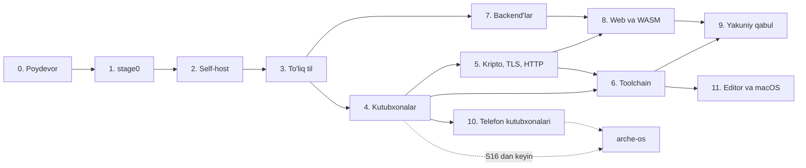

# Arche tili — sprintlar

> 2026-11-10 holati. Asos: [plan.md](plan.md) va [spec/arche-0.md](../spec/arche-0.md). Bootstrap "Real dunyoda ishga tushirish" variantida: stage0 C11'da, release backend LLVM `.ll` orqali. Arche OS sprintlari bu yerda yo'q.

**Joriy sprint:** S38.

**Yopilgan:** S0–S36. Til yakuniy qabuldan o'tdi (S34).

- Compiler o'zini build qiladi (stage2 == stage3), stage0 `stage0-frozen` tag'i bilan muzlatilgan, to'liq til spec'i `spec/arche.md`'da; full-Arche paketlarida generics (monomorphization), comptime interpreter, interface'lar (`impl`, `where`, `&dyn`), `for`, closure'lar (`&dyn fn(P) -> R`), `region` (arena, E0901), `unsafe` va raw pointer'lar, `if`/`match` ifoda sifatida, labeled loop'lar, `f32`/`f64`, `requires`/`ensures`, `nopanic` va error return trace ishlaydi.
- Manifest (`package.arche`) o'qiladi: `needs` (E0801), `strict_unsafe` (E0920), `panic_handler`, xato manifest E0802/E0803.
- Capability'lar `unsafe`ni ham qamraydi: `unsafe` blok, `unsafe`/`naked` fn, `extern` va `export` manifestda `build.Capability.Unsafe`ni talab qiladi (E0801), dependency'ning `unsafe` kodiga root paket `allow_unsafe` bilan nomini yozib ruxsat beradi (E0804). `x catch return y`, `orelse break`/`continue`, `f(today:)` label qisqartmasi, `alloc.String.from`/`clone`/`push_u64`, `Fs.sync` va compiler'ga `--lib <dir>` (bootstrap istalgan papkada ishlaydi) qo'shildi; bular `vazifa` misoli ([arche-family/vazifa](https://github.com/arche-family/vazifa)) taqrizidan chiqdi. Release bootstrap'ning gcc 13'dagi bir martalik farqi `ir/opt.arche`dagi use-after-free'dan edi: `map.items_mut()[id] = constant(f, map: map, …)` ro'yxatni o'stirib, eski xotiraga yozardi va konstanta tarqatish natijasi C allocator'iga bog'liq bo'lib qolardi. Tuzatildi; memory checker endi assignment chap tomonidagi vaqtinchalik view'ni ham tirik deb biladi (E0604), `make -C compiler check-sanitized` va CI'dagi `sanitizers` job'i compiler'ni gcc'ning ASan va UBSan'i bilan build qilib, o'zini va hamma testni debug va release'da o'tkazadi.
- Kutubxona `lib/`'da: `core` (OS va allocator'siz, compiler buni majburlaydi) va `alloc` Arche'da yozilgan; full-Arche paketlari shu `alloc`'ni ishlatadi, compiler ham `--lib-alloc` bilan shu kutubxona ustida bootstrap bo'ladi (stage2 == stage3).
- `freestanding` target'i bor: `asm`, `naked`, volatile, atomic'lar, `packed`/`align`, `section`/`export`, `extern "c"` va panic handler bilan `freestanding/`'dagi dasturlar QEMU'da x86-64 va RISC-V 64'da ishga tushib serial'ga yozadi (CI'da) — arche-os ishi boshlanishi mumkin.
- `std` Linux uchun Arche'da (`lib/std.arche`): Arche-0'ning `System`/`Fs`/`Output`/`Args`'i va `Clock`, `Env`, `Proc`, `Net`, `Rand` capability'lari syscall'lar orqali, `std.json`, `std.path`, `core.rand`; compiler `--lib-std` bilan shu kutubxona ustida ham bootstrap bo'ladi (stage2 == stage3); `arche test` testlarni alohida process'larda, seed bilan, filter va property-based tekshiruv bilan ishga tushiradi.
- Concurrency: `std.task` — structured `scope`, `spawn`, `Channel(T)`, `Shared(T)`, seed'li scheduler (bir xil seed — bir xil tartib), task capture qoidalari (E0902, E0903, E0603), deadlock aniqlanadi.
- Windows host'i ham bor (`arche --target windows-x86_64`): LLVM orqali PE, link `lld-link` bilan, libc'siz — entry point runtime'ning o'zida, `kernel32`/`ws2_32`/`advapi32` import kutubxonalari bilan, `-Brepro` bilan (link vaqti faylga yozilmaydi, shuning uchun bir xil kirish bir xil bayt beradi); target tanlovi bitta joyda — `compiler/target.sh`.
- Runtime ikki yarimga bo'lindi: portativ qism `rt.c`'da, OS'ga xosi `runtime/linux.inc` va `runtime/windows.inc`'da (xotira, fayllar, chiqish, fiber switch — Windows'da TEB'dagi stack chegaralari va o'z `__chkstk`'i bilan, netpoller WSAPoll ustida, va har test uchun bola process: Linux'da `fork`, Windows'da dastur o'zini `--a0-test <raqam> <seed>` bilan qaytadan ishga tushiradi, chiqishi ikki faylga yoziladi).
- `std` har host uchun alohida fayl: `lib/std.arche` (Linux, `std.linux` ustida) va `lib/std-windows.arche` (`std.win32` ustida — yo'llar UTF-16, `Fs` (`FindFirstFileW` bilan `list`), `Clock` (QueryPerformanceCounter va FILETIME), `Env` (`GetEnvironmentVariableW`), `Proc` (`CreateProcessW` + job object: bola bilan birga u boshlagan hammasi tugaydi), `Net` (Winsock, bloklamaydigan socket'lar), `Rand` (RtlGenRandom), `Input`); modul nomi ikkisida ham `std`, uni compiler target bo'yicha tanlaydi (`program.std_file`), `std.SYSTEM` esa dasturga qaysi sistemada ekanini aytadi.
- `Fs.temp_dir` qo'shildi (ikkisida ham), conformance runner `// system: linux|windows` kalitini tushunadi va compiler buyrug'i argumentli bo'lishi mumkin (`--compiler "sh ./arche-build"`: Windows skriptni o'zi ishga tushirmaydi); `.gitattributes` barcha matn fayllarini working tree'da ham LF'da saqlaydi, chunki Arche qatori LF bilan tugaydi va bootstrap baytlarni solishtiradi.
- Windows'da `make -C compiler check` to'liq o'tadi (conformance, `arche test`, roundtrip, golden diagnostika, `arche explain`, doctest), stage0 yo'li ham o'tadi (`make -C conformance check`: stage0 runtime'i Windows'da chiqishni bayt sifatida yozadi va katalogni fayldan ajratadi) va bootstrap'da stage2 == stage3 — debug, `--lib-std` va release uchun; `arche-driver` ham ishlaydi (`driver/check.sh`: cache'dan build toza build bilan bit-identical) va `driver/pkg-check.sh` ham o'tadi — ya'ni o'zimizning TLS va HTTP Windows socket'lari ustida ham ishlaydi; CI'da `windows-latest` job'i shuni takrorlaydi.
- Kripto `lib/crypto/`'da: SHA-256/384/512, HMAC, HKDF, ChaCha20-Poly1305, AES-128/256-GCM, X25519, Ed25519, ECDSA P-256 (RFC 6979 nonce) va ChaCha20 CSPRNG, standart vector'lar bilan; `ctcheck/` dudect usulida (Welch t-testi, ataylab sizdiradigan nazorat funksiyasi bilan) constant-time'ni CI'da har commit'da tekshiradi.
- TLS 1.3 `lib/tls`'da: I/O'siz `Engine` (client va server) va socket ustidagi `Conn`, uchta cipher suite, X25519 va secp256r1, ECDSA P-256 va Ed25519 imzolari, ALPN, KeyUpdate; X.509 parse, zanjir, muddat va host nomi tekshiruvi, PEM, PKCS #8/SEC 1 kalitlar va sertifikat yaratish (`x509.create`); `interop/tls.sh` OpenSSL (s_server, s_client) va curl bilan ikki tomonga interop'ni, `fuzz/tls.sh` handshake va sertifikatlar fuzzing'ini CI'da ishlatadi.
- HTTP `lib/http`'da: HTTP/1.1 (keep-alive, chunked ikki tomonga, 100-continue, request smuggling'ga qarshi framing qoidalari), HTTP/2 (HPACK Huffman va dinamik jadval bilan, stream multiplexing, flow control), `http.server` — har ulanish alohida task va region'da, TLS ustida ALPN bilan h2/http1.1, ochiq matnda h2 prior knowledge; kichik HTTP/1.1 client (`fetch`).
- Runtime'da netpoller: socket'lar bloklamaydi, kutayotgan task boshqalarga yo'l beradi (`poll`); tugagan fiber stack'lari qayta ishlatiladi; `arche test` testlarni parallel (`--jobs`) ishlatadi.
- `interop/http.sh` curl (HTTP/1.1, h2c, TLS ustida h2, multiplexing, katta yuklash/yuklab olish) va headless Chrome bilan, `fuzz/http_fuzz.arche` h1 parser, HPACK va h2 frame'larini CI'da tekshiradi.
- Toolchain buyruqlari: `arche fix` (checker tuzatishlarini qo'llaydi, apply-fixes.py o'rnida), `arche explain` (har xato kodining ma'nosi va misoli; misollar conformance testlaridan generatsiya qilinadi va har biri o'z kodini berishi tekshiriladi), `arche fmt` (sozlamasiz, lossless CST ustida; compiler va lib manbalarida o'zgarishsiz), `arche query def|refs|type|callers`, `arche doc` (Markdown va doc-comment misollari test sifatida, `compiler/doctest.sh`); conformance runner endi Arche'da (`conformance/runner/runner.arche`, `std.Command`/`Proc.spawn` ustida), C11 runner olib tashlandi.
- Edition'lar: 2026 va 2027 (2027'da `ok`/`err` nom, natija pattern'lari `.ok(…)`/`.err(…)`, eskisi E0212 fix bilan), `arche fix --edition` paketni ko'chiradi va qayta tekshiradi.
- Build: `build.arche` dasturlarni sanaydi, `driver/` (to'liq Arche'da, `arche-driver build|run|clean`) compiler'ni va clang'ni boshqaradi — compiler `arche units` bilan har modulni alohida LLVM birligi qilib beradi, har birining obyekti SHA-256 bo'yicha cache'lanadi; bitta modul o'zgarsa faqat u qayta kompilyatsiya bo'ladi va cache'dan build toza build bilan bit-identical (`driver/check.sh`).
- Symbol nomlari endi faqat o'z modulining matniga bog'liq (closure va impl — node raqami, instance — argumentlar hash'i).
- Runtime'ga libc'siz `floor/ceil/trunc/fmod/fma` (va `f` shakllari) qo'shildi — ilgari ular faqat constant-folding tufayli ishlardi.
- Paketlar: `arche-driver pkg add|lock|vendor|publish|keygen`; registry content-addressed (arxiv SHA-256 nomi bilan, o'zgarmas), release yozuvlari Ed25519 bilan imzolangan, `arche-registry` uni HTTPS orqali beradi (o'zimizning TLS va HTTP ustida); `package.lock` har dependency'ni hash bilan qayd etadi, `vendor/<nomi>/`dan compiler topadi, har dependency o'z manifestining `needs`/edition'iga bo'ysunadi; `driver/pkg-check.sh` imzo yoki hash buzilgan paketning, begona kalitning, ikki marta publish'ning rad etilishini va bir xil source + lockfile → bit-identical dasturni tekshiradi.
- Optimizatsiya: `arche --release` (`compiler/ir/opt.arche`) — kichik barg funksiyalarni inline qilish, mem2reg, SCCP, GVN (load'lar va allaqachon tekshirilgan shartlar bilan, shu tufayli sikl testi takrorlagan bounds-check'lar tushadi), LICM, DCE; konstantalardan isbotlangan contract'lar va tekshiruvlar release build'dan tushadi.
- Release'da barcha conformance testlari o'tadi, `bootstrap.sh` release stage2 == stage3'ni va release compiler debug compiler bilan aynan bir xil IR chiqarishini tekshiradi; baseline `bench/baseline.md`'da.
- S36 yopildi: `arche-lsp` (`driver/lsp.arche`, to'liq Arche) JSON-RPC orqali `didOpen`, `didChange`, `didClose`, `didSave`, `publishDiagnostics`, `definition`, `references`, `hover`, `completion`, `formatting` va `codeAction` (fix'lar) beradi; har so'rov compiler'ni alohida process'da ishga tushiradi, saqlanmagan matn `--overlay` bilan uzatiladi.
- Compiler `--package`, `--no-main`, `complete`, `query --json`/`hover` va test binary'si `--json`ni oldi, `std` `sys.stdin`, `Fs.current_dir`, `Fs.make_private_dir`ni oldi (Linux'da 0700, Windows'da faqat egasiga DACL).
- `driver/lsp-check.py` Linux va Windows'da real sessiya o'tkazadi; `compiler/main.arche` ustida `didChange`dan diagnostikagacha eng yomoni 72 ms.
- TextMate grammatikasi `editors/`'da, kalit so'zlari lexer bilan solishtiriladi; xabar parser'i `fuzz/lsp.sh` bilan fuzz qilinadi.
- S27 yopildi: `compiler/x64/` — o'z x86-64 backend'i, IR'dan to'g'ridan-to'g'ri ELF object, LLVM'siz (`arche build x.arche x.o`; skriptlarda va `arche-driver`da `ARCHE_BACKEND=own`, link `lld` bilan): instruction selection, live range'lar ustida linear scan, inline asm uchun kichik assembler, DWARF 4 (qatorlar, funksiyalar, parametr va lokal o'zgaruvchilar, tiplar, `.debug_frame`) va panic'da stack trace (`in f (fayl:qator)`).
- Hamma conformance testlari, test runner va differential u bilan o'tadi, stage2 == stage3 oddiy va `--lib-std` zanjirlarida bajariladi, CI `gdb`da breakpoint, qadamlash va lokal o'zgaruvchilarni tekshiradi.
- Compiler o'zini 0,24 soniyada build qiladi (clang bilan 4,8), kodi esa `clang -O1`nikidan taxminan 2,6 marta sekin.
- S28'da yangi target'lar `linux-aarch64`, `linux-riscv64` va `freestanding-aarch64`: ikkala processor uchun compiler'ning o'z backend'i (`compiler/a64/`, `compiler/rv64/`; umumiy qismi, ya'ni ELF, DWARF va registr taqsimlash, `compiler/native/`'da) va LLVM orqali release.
- Conformance QEMU user-mode'da debug, release va o'z backend bilan o'tadi, `cross-bootstrap.sh` LLVM orqali ham, o'z backend bilan ham stage2 == stage3 beradi, chaqiruv konvensiyasi `docs/abi.md`'da va clang bilan ikki tomonlama solishtirilgan, `freestanding/aarch64.arche` QEMU `virt`da PL011'ga yozadi va CI'da tekshiriladi.
- S29'da `.ao` object format'i (`arche build x.ao`, modul bo'yicha `arche units --ao`, clang'ning ELF object'lari uchun `arche import`), compiler ichidagi static linker (`arche link`, `compiler/link/`), Linux uchun ELF executable va Arche OS loader'i uchun `.ax` format'i; `ARCHE_BACKEND=own` endi LLVM ham, `lld` ham ishlatmaydi: runtime object'i bir marta build qilingach hamma conformance testlari `CLANG=false LLD=false` bilan o'tadi. stage2 == stage3 o'z backend va linker bilan x86-64, ARM64 va RISC-V 64'da bajariladi, `gdb` sessiyasi linker chiqargan fayl bilan ishlaydi.
- ABI hujjati yakunlandi, ABI test suite (`compiler/abi-check.sh`, `conformance/abi/`) har layout'ni uch modul orasida o'tkazadi, har modul LLVM va o'z backend bilan alohida build qilinib to'rt xil aralashmada link qilinadi; ataylab buzilgan RISC-V konvensiyasini faqat aralash build'lar ushlashi tekshirildi.
- Buzilgan object'lar linker'ni panic'ga olib bormaydi, `own-check.sh` shuni baytlarni o'zgartirib tekshiradi.
- S30'da `--target wasm32-wasi`: compiler'ning o'z WASM backend'i (`compiler/wasm/`, stack codegen, har blok bitta `loop` + `br_table` ichida, shu sabab istalgan control flow ishlaydi), WASI ustidagi `lib/std-wasi.arche` va Arche'da yozilgan runtime (`lib/std/wasi_rt.arche`).
- Pointer'lar 8 bayt qoladi va xotiraga borishda 32 bitga o'raladi, shuning uchun layout'lar boshqa target'lar bilan bir xil.
- Conformance `wasmtime`da o'tadi, Proc, Net va task kerak bo'lgan testlar `// wasm: skip` bilan o'tkaziladi; compiler'ning o'zi WASM'da ishlaydi, o'zini build qiladi (stage2 == stage3) va Linux dasturini ham chiqaradi.
- Shu sprintda `lib/alloc`'dagi `Map` xatosi topildi: `remove`dan keyingi `get` eski qiymatni qaytarardi, tuzatildi.
- S31'da WASM runtime Arche'da (`wasm/`, alohida paket): decoder, validator (body'ni yo'l-yo'lakay interpreter kodiga kompilyatsiya qiladi), store, instantiate va interpreter; dvigatel modullari faqat `core` va `alloc`'ga tayanadi. WebAssembly 2.0 spec testsuite'i (`wg-2.0`, SIMD'siz, wabt 1.0.36'ning `wast2json`i bilan) interpreter'da ham, JIT bilan ham o'tadi: 27416 tekshiruv, matn formatidagi 581 ta `assert_malformed` binar dvigatelniki emas.
- Baseline JIT x86-64 uchun (`wasm/jit.arche`): instruksiyalar o'sha qiymat stekida mashina kodi bo'ladi; kompilyatsiya qilinmaganini, chaqiruv, qaytish va soatga qarashni bittadan interpreter'ga qaytaradi, shuning uchun frame'lar bitta va trap har doim interpreter'niki. Spec testlarida mashina kodi 368884 marta ishladi va interpreter'ga 135562 instruksiya qaytardi; sikl va rekursiya JIT bilan taxminan 11 marta tez.
- Component Model (`wasm/component.arche`): bo'limlar tartibi bilan o'qiladi va instantiate qilinadi, canonical ABI string, list, record, tuple, variant, enum, option, result va flags'ni ikki tomonga, flat va xotira orqali o'tkazadi (realloc va post-return bilan). Import qilingan instance'ning har funksiyasi host'da bo'lishi shart, aks holda component rad etiladi.
- Nimadir host'i oynasiz (`wasm/nimadir.arche`, `arche-wasm nimadir`): `nimadir:shell@1.2.0`'ning `host-api` va `dom` interfeyslari (markup, entity va descendant selector'li element daraxti) va shell chegaralari: frame'ga 1 s, init'ga 10 s, 512 MiB xotira, frame'da 16 MiB va 65536 widget, 1 MiB storage. `counter`, `hello` va `store` qayta build qilinmasdan ishlaydi; `runaway` deadline'da (1,00 s), 512 MiB'da va host chegarasida to'xtatiladi; `nimadir-check.sh` buni interpreter'da ham, JIT bilan ham tekshiradi. Deadline'ning soatini embedder closure sifatida beradi, dvigatel o'zi soat o'qimaydi.
- S32'da `lib/web` (router — `/users/:id`, `/files/*path`, method'lar, percent-decoding; middleware — `around`, `Gzip`, `Security`; static fayllar, katalogdan chiqib bo'lmaydi), `core.deflate` (DEFLATE, inflate, gzip, CRC-32), `Proc.cpu_count` va `Proc.workers` (har CPU'ga worker, bitta listener'ni bo'lishib). `examples/webapp` TLS 1.3 ustida HTTP/2 va HTTP/1.1 bilan static fayl va JSON API beradi; `check.sh` curl bilan tekshiradi, bitta worker'ning xotirasi 20000 so'rovdan keyin ham 432 KiB'da qoladi. Shu tufayli runtime'dagi ikki oqish topildi: task closure'ining nusxasi va fayl yo'lining C nusxasi hech qachon bo'shatilmasdi.
- S33'da `lib/kv`: sahifali B+ tree va WAL (commit'da o'zgargan sahifalar CRC va salt bilan log'ga, checkpoint, ochishda faqat to'liq commit'lar qayta qo'llanadi), `std.File` (offset'da o'qish/yozish, `size`, `truncate`, `sync` — Linux, Windows, WASI). `examples/kvcrash` yozuvchini 30 marta SIGKILL qiladi: har commit qilingan tranzaksiya to'liq, hech biri qisman emas. `arche-wasm serve` HTTPS so'rovni sandbox'dagi WASM modul (`handle`) bilan javoblaydi: faqat `arche.log` va `arche.now_ms` import qilinadi, 100 ms va 64 MiB chegarasida 503 va yangi instance. `bench/web` throughput va p99'ni o'lchaydi va baseline bilan solishtiradi (JSON 248773 so'rov/s, p99 193 µs). Runtime region chunk'larini qayta ishlatadi: JSON 150k'dan 250k so'rov/s'ga chiqdi.
- S34'da conformance 2067 testga yetdi: 1565 tasini `conformance/gen/gen.py` o'z modelidan kutilgan natijani hisoblab yozadi (butun sonlar va ularning trap'lari, cast'lar, `List`/`Map`/`String`, compile xatolari, `std.json`, `core.deflate`, router, `kv`); hammasi compiler, o'z backend, release, ARM64 va RISC-V'da, Arche-0 qismi stage0'da ham o'tadi. `compiler/fuzz.py` checker qabul qilganini build ham qiladi (lowering va optimizer) va comptime interpreter'ga tasodifiy rekursiyalar beradi. `dist.sh` versiyalangan arxiv chiqaradi (`arche`, `arche-driver`, `arche-lsp`, `lib/`, runtime va uning o'z linker uchun object'i; bir xil daraxtdan bir xil baytlar), `arche-driver` clang bo'lmasa o'z backend bilan build qiladi; CI'da `release` (avval web benchmark baseline'ni ushlashi kerak), `clean-machine` (C compiler'siz `ubuntu:24.04` konteynerida arxivdan dastur build qilinib ishga tushadi) va `reproducible` (Ubuntu 24.04 va 22.04'da compiler o'z source'idan bir xil release IR va object chiqaradi). Litsenziya: MIT OR Apache-2.0.
- S32–S33'ning ochiq qolganlari yopildi. `comptime if` (spec §4.4): instance'da faqat tanlangan shox tekshiriladi va kompilyatsiya qilinadi. `core.meta` tipning `pub` maydonlarini (soni, nomi, turi, view'i), `is_int`, `is_list`, `same` kabi savollarni, `zeroed`ni beradi; `unsupported(T)` E0841 bo'lib, paketdagi chaqiruv joyida chiqadi. Shular bilan Arche'da yozilgan `std.json.encode`/`decode` struct, `String`, butun son, `bool`, `?T` va `List(T)`ni JSON'ga yozadi va o'qiydi (son tipga sig'masa `Mismatch`). `web.render` template'ga (`{{name}}` HTML escape bilan, `{{&name}}`, `{{#x}}…{{/x}}`, `{{^x}}`) maydonlarni qo'yadi; makro tili yo'q. Linux'da fayl syscall'lari alohida fayl thread'ida bajariladi (cache'dagi fayl `openat2` RESOLVE_CACHED va `preadv2` RWF_NOWAIT bilan darhol o'qiladi), shu vaqtda worker'ning boshqa task'lari ishlaydi va scheduler har 16 tanlovda socket'larga qaraydi. KV store'da o'chirishdan keyin kichrayib qolgan sahifa qo'shnisi bilan birlashadi, bitta bolali root o'rnini bo'shatadi, bo'shagan sahifalar free list orqali qayta ishlatiladi.
- Arche OS'ning O12 ochiq qolgani uchun interface'lar ham comptime'da so'raladigan bo'ldi (spec §4.3, §5.4). `core.meta` interface metodlarining sonini, nomini, `self`dan keyingi parametrlarining soni va turini, natija turini aytadi. `meta.call(I, M, d, a…)` metodni raqami bo'yicha `&dyn I` orqali chaqiradi. Argumentlari metodnikidek tekshiriladi, lekin label talab qilinmaydi, chunki metodni raqam bilan tanlagan kod parametr nomlarini bilmaydi. `impl I for T = f;` har metodni `f(I, M, self, args)` qiladi. `args` — `core.meta.Args(I, M)`, chaqiruv argumentlarining view'i (ikkinchi darajali, maydon bo'la olmaydi, E0601); `meta.arg(I, M, P, args)` P-argumentni beradi, view bo'lsa `args`ning projection'i sifatida. `f`ning har metod uchun instance'i metodning `self`ini, `Args`ni olishi va natijasini berishi tekshiriladi (E0822). `elem_type` endi `X!E`ning `E`sini ham beradi. Shular bilan kanal ustidagi klient stub'i va server dispatch'i har interface uchun bir marta Arche'da yoziladi, makro tilisiz (arche-os `user/protocols.arche`). Conformance'da 8 ta yangi test bor: ikkita ishlaydigan dastur (jarayon ichidagi to'liq stub/dispatch aylanishi) va E0841, E0822, E0601 xatolari.
- S5 yopildi: `compiler/fuzz.py` 24 CPU-soat ishladi (16 jarayon × 1,5 soat, CI esa har commit'da 60 soniya). 79503658 kirishning hech birida parser yiqilmadi va CST har birini bayt-ba-bayt tikladi. Checker bitta kirishda yiqildi: comptime parametrli `main` E0313 o'rniga panic berardi. Bu tuzatildi va test qo'shildi.
- Yo'l-yo'lakay: `core.float` (`bits64`, `from_bits64` va 32 bitlik juftlari: float bitlari, NaN payload'i bilan), `alloc.List.with_capacity`/`grow_zeroed`, `String.push_utf8`; `-2^63 as i64` noto'g'ri trap berardi (f64'da `-2^63 - 1` yo'q), tuzatildi. CI bootstrap'ni clang 20 bilan qiladi: LLVM 18'ning SCCP'si bir xil IR'dan ba'zan boshqa kod chiqarardi (llvm/llvm-project#105758).

**Ochiq qolganlar:**

- S32'da `std.json.encode`/`decode` va `web.render` float'ni hali bilmaydi (`core.fmt`'da float yo'q), `web.render` template'ni run time'da o'qiydi, shuning uchun template'dagi noma'lum nom ham run time xatosi (comptime `str` qiymatlari yo'q). S33'da Windows'da fayl o'qish hali worker'ni to'xtatadi.

- S31'da Component Model'ning resource'lari, ichma-ich component'lar va UTF-16 string'lar hali yo'q (C# va Python component'lariga kerak); core modullar uchun WASI host'i (capability'lar WASI import sifatida) va JIT'ning ARM64/RISC-V varianti keyinroq; JIT hozircha `div`, float→int, float min/max, jadvallar va `call_indirect`ni interpreter'ga qaytaradi.

- S11'dagi comptime interpreter hozircha faqat integer va `bool` kodni bajaradi.
- S12'da `where` bilan cheklangan `T` qiymatida faqat constraint method'lari qolishi hali tekshirilmaydi, generic `impl` va `core.Iter` S15'da.
- S13'da closure'ni `comptime F: type` bilan olish (turini nomlash) S15'da `core` bilan, `  S14'da contract shartlarining side effect'siz ekanligi hali tekshirilmaydi, release build (isbotlangan shartlarni olib tashlash) S26'da, `nopanic` isboti hozircha faqat literal'lar bilan ishlaydi.
- S15'da Allocator hozircha handle (dastur heap'i yoki region arena'si, runtime'da C'da): page, pool va general allocator'larni Arche turlari sifatida Allocator interface'i orqali ulash, `core.fmt`'da float, Arche-0 paketlarida standart holda kutubxona `alloc`'i (stage0 o'zinikini ishlatadi) keyinroq.
- S16'da konstantalarga `section` hali yo'q, `core.atomic.U32` kabi turlar S18'da, `naked` va `asm`'ning 32-bitlik boot kodini tekshirish faqat QEMU orqali.
- S17'da `Fs`'ni katalogga toraytirish (`within`) va Net'da IPv6/UDP/DNS keyinroq, Arche-0 paketlari standart holda hali compiler'ning o'z std'ini ishlatadi.
- S18'da task'lar bitta OS thread'da fiber sifatida ishlaydi: socket'lar S22'dan beri, Linux'da fayllar ham bloklamaydi, lekin `sleep_ns` va Windows'da fayl hali hammasini to'xtatadi, ko'p protsessorda parallel worker'lar keyinroq; `core.atomic.U32` kabi turlar hali yo'q.
- S20'da AES dasturiy (AES-NI yo'q, sekin), X25519 TweetNaCl usulida — tezlashtirish S26'da.
- S21'da RSA va P-384 sertifikatlari (internetdagi ko'p serverlar), HelloRetryRequest, session resumption/0-RTT va client sertifikatlari yo'q, sertifikat bekor qilinishi (CRL/OCSP) tekshirilmaydi.
- S22'da HTTP/2 client, server push, HPACK encoder'ning dinamik jadvali va h2c Upgrade yo'q, javob tanasi to'liq xotirada yig'iladi (streaming yo'q), uzoq yashaydigan h2 ulanishida so'rovlar xotirasi ulanish yopilguncha qaytmaydi.
- S23'da `arche query` struct literal maydonlari, variant'lar va comptime parametrlarini hali bog'lamaydi, `arche fmt` qatorlarni bo'lmaydi va qo'shmaydi (faqat indentatsiya, bo'shliqlar va bo'sh qatorlar), E0801 va E0920 misollari manifest bilan S24'da qo'shildi.
- S24'da compiler Arche-0'da qolgani uchun `arche build`/`run` alohida `arche-driver` dasturi, front-end (tekshiruv) har build'da butun dasturni qayta tekshiradi (tez: ~60 ms), cache faqat backend (clang) ishini saqlaydi, `dependencies` o'qiladi.
- S25'da versiyalar aniq (range va semver yechimi yo'q, bitta paketning ikki versiyasi xato), registry host'i IPv4 yoki localhost (DNS yo'q), registry bitta kalit bilan imzolaydi (har publisher'ning o'z kaliti keyinroq).
- S26'da optimizer module chegarasidan o'tib inline qiladi, lekin faqat barg funksiyalarni, load'larni LICM ko'tarmaydi, `arche-driver` hali `--release` bermaydi, `ctcheck` faqat debug build'ni o'lchaydi, `nopanic` isboti optimizer natijasidan foydalanmaydi.
- S19'da Windows'da standart kirishni o'qish butun dasturni to'xtatadi (netpoller faqat socket'larni kuzatadi; Linux'da fayllar alohida thread'da o'qiladi), `std.path` yo'l ajratuvchisi sifatida faqat `/`ni biladi (`is_absolute` disk nomini ham tanidi), kripto/TLS/HTTP interop (OpenSSL, curl, Chrome), `ctcheck`, freestanding QEMU va parser fuzzing CI'da Linux job'ida qoladi, Windows'da UTF-8 konsol uchun code page o'zgartiriladi, MSYS shell'i native programmaga `/` bilan boshlanadigan argumentni yo'l deb o'zgartiradi (shuning uchun linker flag'lari chiziqcha bilan va `pkg-check.sh`'da `MSYS2_ARG_CONV_EXCL`), runner'ning o'z selftest'i Windows'da o'tkazib yuboriladi (mock compiler ham, u yozgan "dastur" ham shell skript — Windows ularni o'zi ishga tushirmaydi; runner'ning o'zi conformance to'plami bilan sinaladi).
- S36'da server hujjatni butunligicha oladi (incremental sync yo'q), `rename` va workspace bo'yicha qidiruv yo'q, editor plaginlari bu repo'da emas.
- S27'da release build, Windows va freestanding LLVM orqali qoladi (o'z backend'i optimizer'ning phi'larini olmaydi), `rt.c` hali clang bilan build qilinadi, `arche-driver`da default LLVM (`lld` tarqatish bilan S34'da keladi), DWARF'da scope yo'q (o'zgaruvchi butun funksiyada ko'rinadi), assembler faqat `nop`, `ret`, `pause`, `syscall`, `rdtsc`, `cpuid`, `hlt`, `mfence`, `ud2`, 32 va 64 bitli `mov`, `add`, `sub`, `and`, `or`, `xor`, `cmp`, `jmp` va shartli jump'larni biladi.
- S28'da o'z backend'i faqat Linux'ning debug build'lari uchun (freestanding ARM64 va RISC-V LLVM orqali), RISC-V'da statik dastur 2 GB'dan past turadi, ARM64'ning shartli branch'i va RISC-V'ning jump'i ±1 MB'dan uzoqqa yetmasa compiler xato beradi, assembler'lar kichik (faqat `svc`, `ecall`, `nop`, `ret`, `wfi`, `mov`/`mv`, `li`, `add` va shu kabi registr amallari); `extern "c"`ga manfiy `i8`/`i16` x86-64 va RISC-V'da nol bilan kengaytirilib boradi, chunki IR ishorani bilmaydi.
- S29'da runtime (`rt.c`) hali clang bilan bir marta build qilinadi (tarqatish bilan S34'da keladi), freestanding va Windows `lld`/`lld-link` bilan qoladi (linker script yo'q), ishlatilmagan section'lar tashlanmaydi, satrlar birlashtirilmaydi, RISC-V relaxation yo'q (clang `-mno-relax` bilan), `.ax`'da debug info yo'q, unga Arche OS loader'i hali yo'q (sinov uchun `compiler/tests/ax-load.c`), `arche-driver`ning kesh qiladigan modul build'lari LLVM orqali qoladi, kompozit qiymatlar plandagidek register'da emas, xotirada qaytariladi (`docs/plan.md` shunga moslandi).
- S30'da WASM uchun release build yo'q (optimizer'ning phi'lari), `arche test` yo'q (runner har testni child process'da ishga tushiradi), DWARF yo'q (faqat `name` section), task, Proc, Net va `asm` yo'q, `Fs.current_dir` `.` qaytaradi, kod `loop` + `br_table` shakli sabab sekinroq (structured control flow yozilmagan), import'lar faqat `wasi_snapshot_preview1`.

## Qoidalar

- Sprint sana bilan emas, qabul mezoni bilan yopiladi. Qabul mezoni CI'da avtomatik tekshiriladi.
- Til imkoniyati bitta sprintda uch qism bilan birga keladi: spec matni, conformance testlari va implementatsiya. Har qoidaga kamida bitta ijobiy va bitta salbiy test to'g'ri keladi.
- Compiler source'i doim Arche-0'da qoladi. S9'dan boshlab har sprint to'liq bootstrap va stage2 == stage3 tekshiruvi bilan yopiladi.
- S5'dan boshlab har yangi xato kodi `arche explain` uchun misol va test bilan qo'shiladi.
- Fuzzing komponent paydo bo'lgan sprintda boshlanadi va keyin doimiy ishlaydi.
- Sprint rejadagi qarorni o'zgartirsa, `plan.md` va spec shu sprintning o'zida yangilanadi.

## Umumiy ko'rinish

| Bosqich | Sprintlar | Natija |
| --- | --- | --- |
| 0. Poydevor | S0 | test format'i, runner, CI |
| 1. stage0 | S1–S4 | Arche-0 → C tarjimon |
| 2. Self-host | S5–S9 | Arche-0'da yozilgan compiler, stage2 == stage3 |
| 3. To'liq til | S10–S14 | to'liq spec, compiler'da til imkoniyatlari |
| 4. Kutubxonalar | S15–S19 | `core`, `alloc`, `std` (Linux, Windows), `freestanding` |
| 5. Kripto, TLS, HTTP | S20–S22 | OS'ga bog'liq bo'lmagan tarmoq kutubxonalari |
| 6. Toolchain | S23–S25 | `arche` buyruqlari, build tizimi, package manager |
| 7. Backend'lar | S26–S30 | optimizatsiya, o'z backend'lari, linker, WASM |
| 8. Web va WASM | S31–S33 | WASM runtime, web server |
| 9. Yakuniy qabul | S34 | rejaning yakuniy qabul mezoni |
| 10. Telefon kutubxonalari | S35, S38–S39 | Arche OS telefoni uchun: shrift, PNG, D-Bus, `std.linux` qo'shimchalari; Arche'dan WASM component; ARM64 JIT |
| 11. Editor va macOS | S36–S37 | `arche-lsp` va editor integratsiyasi; macOS target |

Bosqichlar raqam tartibida yoziladi. Bir nechta ishchi bo'lsa, grafikdagi parallel tarmoqlar bir vaqtda olib borilishi mumkin.

## 0. Poydevor

### S0. Infratuzilma

- `stage0/`: C11 loyiha skeleti va Makefile. gcc va clang bilan `-std=c11 -Wall -Wextra -Werror` ostida build bo'ladi.
- `conformance/` va test format'i. Har test bitta `.arche` fayl bo'ladi. Kutilgan natija fayl boshidagi izohlarda yoziladi: stdout, exit kodi yoki compile xato kodi. §12'dagi tekshiruvlarning salbiy testlari "stage0 o'tkazib yuborishi mumkin" deb belgilanadi.
- Test runner C11'da yoziladi, chunki u Arche paydo bo'lguncha ishlashi kerak. Keyin uni `arche test` almashtiradi.
- CI (GitHub Actions, Linux): har commit'da stage0 build va conformance testlari ishlaydi.
- Hujjatlardagi ma'lum nomuvofiqliklar tuzatiladi:
  - `plan.md`'dagi `Shared<T>` → `Shared(T)`.
  - `plan.md`'dagi `alloc` qatoridagi `StringBuilder` §11'dagi `alloc.String` bilan moslashtiriladi.
  - §7.4'dagi struct literal cheklovi §14'dagi "grammar ifodalamaydigan cheklovlar" ro'yxatiga qo'shiladi.

**Qabul:** CI yashil. Runner namunaviy ijobiy va salbiy testlarni to'g'ri baholaydi.

## 1. stage0 (C11, Arche-0 → C)

Bosqich natijasi: stage0 spec'dagi Arche-0'ni to'liq qabul qiladi va stage1 source'ini compile qilishga tayyor bo'ladi.

### S1. Boshidan oxirigacha ishlaydigan eng kichik dastur

- Lexer §2 bo'yicha to'liq: barcha token'lar, literal'lar, escape'lar, `as%`, doc comment'lar, string tashqarisidagi `\r` xatosi.
- Parser eng kichik qism uchun: `import`, `fn`, method chaqiruvi, string literal, `return`.
- C emitter va runtime: `std.System`, `Output`, `Args`. Chiqishda `Output` flush qilinadi.
- `panic` built-in'i: `panic: <xabar>` source joyi bilan chiqadi va status 101.

**Qabul:** `sys.stdout.write("hello\n")` dasturi gcc va clang bilan build bo'lib ishlaydi. Lexer conformance testlari o'tadi.

### S2. Ifodalar va boshqaruv

- §14'dagi to'liq grammar uchun parser. Xato xabari fayl va qator raqamidan iborat.
- Butun son turlari, literal turi kontekstdan (§5.6), `const`, `let`/`var`, compound assignment.
- Arifmetika (§7.2): nolga bo'lish, shift kengligi va `as` trap'lari, `as%`. Precedence (§7.1) va hisoblash tartibi (§7.3).
- `if`, step'li `while`, `break`/`continue`, barcha chiqish yo'llarida `defer`, funksiyalar, rekursiya, `assert`, `unreachable`.

**Qabul:** §7 va §8 conformance testlari, trap testlari bilan birga, o'tadi.

### S3. Turlar, match va modullar

- `struct` (method'lar, associated funksiyalar, `self` turlari), payload'li `enum`, error set'lar (global error nomlari), `[N]T`, alias.
- View'lar: `&T`, `&mut T`, `[]T`, `str`. Indekslash va slicing bounds trap'i va UTF-8 chegarasi trap'i bilan.
- `match` (§9): barcha pattern'lar, copy va move bilan binding, hech biri mos kelmasa trap.
- Modullar (§3): ko'p fayl, `import … as`, import cycle'lar; dastur butunligicha compile qilinadi.
- `alloc.List(T)`: `Ast` misoli uchun kerak, shuning uchun S4 dan shu yerga olindi (`pop` S4 da, chunki u `?T` qaytaradi).
- `==` va `!=` (§5.5), struct'larda field bo'yicha.

**Qabul:** §15'dagi `Ast` misoli va ko'p modulli dastur ishlaydi. §3, §5 va §9 conformance testlari o'tadi.

### S4. Optional, xatolar va kutubxona

- `?T`, `E!T`, `try`, `catch`, `orelse`, return lifting, `some`/`none`/`ok`/`err` pattern'lari. `try` xato bilan chiqqanda ham `defer` ishlaydi.
- `main` xato qaytarsa, `error: Name` chiqadi va status 1.
- §11 runtime'i to'liq: `List.pop`, `Map` (qo'shilish tartibida), `String`, `Interner`, `Fs.read_file`/`write_file`.

**Qabul:** §15'dagi `lines` dasturi ishlaydi. stage0 o'tkazib yuborishi mumkin deb belgilanmagan barcha conformance testlari o'tadi.

## 2. Self-host (compiler Arche-0'da)

Bosqich natijasi: `compiler/` Arche-0'da yozilgan va o'zini build qiladi. Pipeline: source → CST → typed AST → SSA IR → `.ll`.

### S5. Frontend

- Lexer, LL(1) parser, error recovery, lossless CST.
- Diagnostika infratuzilmasi: barqaror xato kodlari, aniq joy, matn va JSON format, fix'lar edit sifatida.
- Parser fuzzing boshlanadi.

**Qabul:** compiler stage0 bilan build bo'ladi. CST'dan source bayt-ba-bayt tiklanadi: compiler'ning o'z source'i va barcha conformance fayllari uchun. Syntax testlari to'g'ri xato kodlari bilan o'tadi. Parser 24 soat fuzz qilinganda crash bo'lmaydi.

### S6. Nomlar va turlar

- Name resolution: modullar, import, scope, visibility.
- Arche-0 uchun type checker: lokal type inference, literal konteksti.
- §12'dagi barcha erasable tekshiruvlar, har biri o'z xato kodi bilan.

**Qabul:** Arche-0'ning barcha conformance testlari, salbiylari ham, to'g'ri xato kodi bilan o'tadi.

### S7. Memory checker

- §5.4: view qayerda turishi mumkinligi, projection, path bo'yicha exclusivity.
- §5.5: move'dan keyin foydalanish, `match`'dagi move.
- Har qoida o'z xato kodi bilan. Memory checker fuzzing boshlanadi.

**Qabul:** memory model testlari o'tadi. Compiler'ning o'z source'i memory checker'dan xatosiz o'tadi.

### S8. SSA IR va LLVM backend

- Typed AST → SSA IR lowering. Har pass'dan keyin IR verifier ishlaydi.
- IR → LLVM textual `.ll` (x86-64 Linux), executable'ni `clang` build qiladi.
- Arche-0 built-in turlari (`List`, `Map`, `String`, `Interner`) va §11'dagi `std` qismi compiler intrinsic'lari sifatida IR'ga tushiriladi. Host bilan aloqa libc'siz, to'g'ridan-to'g'ri Linux syscall'lari orqali bo'ladi.
- ABI hujjati v0: layout'lar (slice, `?T`, `E!T`, enum) va symbol mangling.
- Panic'da fayl va qator chiqadi.

**Qabul:** differential test: Arche-0 dasturlari stage0 orqali ham, yangi backend orqali ham bir xil natija beradi. Barcha run-time conformance testlari o'tadi.

### S9. Self-host

- Bootstrap skripti: stage0 → stage1 → stage2 → stage3.
- Output deterministik bo'ladi: unga vaqt, absolyut yo'llar va hash tartibi ta'sir qilmaydi.
- CI'da bootstrap har commit'da, differential test (stage1 va stage2) har kuni ishlaydi.
- stage0 muzlatiladi (git tag) va bundan keyin faqat bootstrap tekshiruvi uchun saqlanadi.

**Qabul:** toza Linux mashinada, faqat C compiler va LLVM bilan, bootstrap o'tadi va stage2 == stage3 bit-identical chiqadi.

## 3. To'liq til

Bosqich natijasi: to'liq spec bor va compiler concurrency hamda past darajadan tashqari barcha til imkoniyatlarini qo'llaydi. Compiler source'i Arche-0'da qoladi.

### S10. To'liq til spec'i

- `spec/` tuzilishi va to'liq tilning EBNF grammar'i.
- Arche-0'da yo'q imkoniyatlar bo'yicha ochiq qarorlar yopiladi: generic sintaksisi, closure'lar va ularning capture qoidalari, `for` va iterator protokoli, `if`/`match` ifoda sifatida, float semantikasi, `region` sintaksisi, `Shared(T)`.
- Memory model to'liq yoziladi: reference qochishi, region chegarasi, move'dan keyin foydalanish. Har qoidaga xato kodi biriktiriladi.

**Qabul:** spec 60 sahifadan oshmaydi. Arche-0'ning har qoidasi to'liq spec'da o'zgarishsiz turadi (strict subset).

### S11. Comptime va generics

- Comptime interpreter IR ustida ishlaydi: sandbox, I/O yo'q, qadamlar soni cheklangan.
- `comptime` parametrlar, generic tur va funksiyalar, monomorphization.
- Comptime profiler.

**Qabul:** generics va comptime conformance testlari o'tadi. Comptime fuzzing boshlanadi.

### S12. Interface'lar va iteratsiya

- `interface`, `where` constraint'lar, `dyn I` orqali dynamic dispatch.
- `for` sikli iterator protokoli orqali.

**Qabul:** interface, `where`, `dyn` va `for` conformance testlari o'tadi.

### S13. Region, unsafe va closure'lar

- `region` va region escape tekshiruvi.
- `unsafe` blok va `*T` raw pointer. Undefined behavior faqat `unsafe` ichida bo'lishi mumkin.
- Closure'lar S10'da belgilangan capture qoidalari bilan.

**Qabul:** to'liq tilning memory model testlari o'tadi, har xato o'z kodi bilan.

### S14. Qolgan til imkoniyatlari

- `if` va `match` ifoda sifatida; labeled `break`/`continue`.
- `f32`, `f64`.
- `requires`/`ensures`: debug build'da tekshiriladi.
- `nopanic` belgisi va uning tekshiruvi; error return trace.

**Qabul:** S10 spec'ining concurrency va past darajadan tashqari barcha bo'limlari implementatsiya qilingan, ularning conformance testlari o'tadi.

## 4. Kutubxonalar

### S15. `core` va `alloc`

- `core`: primitive op'lar, slice, `?T`/`E!T` helper'lari, `Eq`, `Ord`, `Hash`, `Iter`, allocator'siz fmt, math, UTF-8.
- `alloc`: `Allocator` interface; page, arena, pool va general allocator'lar; region runtime; `List`, `Map`, `Set`, `String`, `Interner`.
- Compiler intrinsic'lari kutubxona bilan almashtiriladi: Arche-0 turlari endi `alloc`'dan keladi, signature'lari §11 bilan bir xil.

**Qabul:** `core` OS'siz va allocator'siz build bo'ladi. Intrinsic'larsiz bootstrap'da ham stage2 == stage3.

### S16. Past daraja va `freestanding`

- `asm` blok, `naked` funksiyalar, `volatile` o'qish/yozish, atomic'lar va memory ordering, memory barrier'lar.
- `packed`, `align(N)`, aniq field tartibi, section va link nazorati.
- Panic handler'ni almashtirish, target ISA tanlash.
- `freestanding` target: `std`'siz build.
- Bu imkoniyatlarning hammasi `unsafe` ichida ishlaydi.

**Qabul:** faqat `core` va `alloc` bilan build bo'lgan freestanding binary QEMU'da (x86-64 va RISC-V 64) ishga tushib serial'ga yozadi. Shundan keyin arche-os ishi boshlanishi mumkin.

### S17. `std`: Linux host

- Capability turlari: `Fs`, `Net`, `Clock`, `Env`, `Proc`. Fayl, process, time, path, JSON.
- Test runner: `test` bloklari, filter, har doim chiqariladigan seed. Property-based test, seed'li random.
- Linux backend libc'siz, syscall'lar orqali ishlaydi.

**Qabul:** `std` testlari Linux'da o'tadi. Compiler §11'dagi `std` qismini shu kutubxonadan oladi, bootstrap'da stage2 == stage3.

### S18. Concurrency

- Structured scope, task'lar, task'lar orasida move, channel, `Shared(T)`.
- Testlar uchun seed'li scheduler.

**Qabul:** concurrency conformance testlari o'tadi. Seed'li scheduler bir xil seed bilan bir xil tartibni takrorlaydi.

### S19. Windows

- Windows target (`--target windows-x86_64`): LLVM orqali PE, link uchun `lld-link`, libc'siz. Runtime o'z entry point'ini beradi, Win32 import kutubxonalaridan foydalanadi va link `-Brepro` bilan takrorlanadigan bo'ladi. Target'ga bog'liq hamma narsa `compiler/target.sh`'da.
- Runtime ikkiga bo'linadi: portativ qismi `rt.c`'da qoladi, OS'ga xosi `runtime/linux.inc` va `runtime/windows.inc`'da — ikkisi ham `rt.c` boshida e'lon qilingan `os_` funksiyalarini beradi. Fiber switch Windows ABI'si bo'yicha (rdi/rsi va xmm6–15 saqlanadi), TEB'dagi stack chegaralari har switch'da yangilanadi va `__chkstk` o'zimizning bo'ladi; netpoller WSAPoll ustida.
- `arche test` har testni alohida process'da ishlatadi. Windows'da `fork` yo'q: dastur o'zini `--a0-test <raqam> <seed>` bilan qaytadan ishga tushiradi, bola chiqishini ikki faylga yozadi, ota tugagach o'qiydi.
- `std`'ning Windows backend'i: modul nomi ikkisida ham `std`, lekin fayl har host uchun alohida (`lib/std.arche`, `lib/std-windows.arche`) va compiler uni target bo'yicha tanlaydi; Win32 chaqiruvlari `lib/std/win32.arche`'da, `std.linux`'ning egizagi. Sistemalar farq qilgan joy aytib qo'yiladi: Windows'da signal yo'q (`Ending.Signaled` kelmaydi), bola bilan birga u boshlagan hammasi tugaydi (job object), `env` massivi yo'q (har nom alohida so'raladi).
- `std.SYSTEM` (`"linux"` yoki `"windows"`) va `Fs.temp_dir`: portativ dastur sistemani bilib oladi va vaqtinchalik fayllarni qayerga qo'yishni so'raydi.
- Test formati `// system: linux|windows` kalitini oladi: faqat bitta sistemada ma'noli test (masalan xom syscall) boshqasida o'tkazib yuboriladi. Conformance runner'ning compiler buyrug'i argumentli bo'lishi mumkin, chunki Windows skriptni o'zi ishga tushirmaydi (`--compiler "sh ./arche-build"`).
- Paket arxividagi yo'l hamma sistemada bir xil ma'noda bo'lishi kerak: `safe_path` `\\`, `:`, oxiri nuqta yoki bo'sh joy bilan tugaydigan qism va `CON`, `NUL` kabi qurilma nomlarini hamma joyda rad etadi, `pkg publish` ham bunday faylni nashr qilmaydi. Paket nomi identifikator, versiya esa harf, raqam, `.`, `-` va `+` bo'ladi (E0802); lock fayldagi nom ham shunday tekshiriladi. `std.path` target'ning qoidasi bilan ishlaydi: Windows'da `\\` ham ajratadi va disk nomi yo'lning bir qismi, Linux'da ular oddiy belgi. Driver cache kaliti runtime'ning hamma fayllarini (`rt.c` va `*.inc`) oladi. Buyruq qatori `PATH_UNITS` bilan cheklanmaydi (Windows chegarasi 32767).
- `.gitattributes`: repodagi matn fayllari working tree'da ham LF bo'ladi — Arche qatori LF bilan tugaydi (CR xato), `.sh` skriptlar `sh` bilan ishlaydi va bootstrap baytlarni solishtiradi.

**Qabul:** compiler va `std` testlari Windows'da o'tadi, Windows'dagi bootstrap'da stage2 == stage3. Bajarildi: `make -C compiler check` Windows'da to'liq o'tadi (458 conformance testi o'tadi, uchtasi Linux'ga xos bo'lgani uchun skip: xom syscall, SIGPIPE va `path`ning Linux qoidalari), stage0 bilan ham (`make -C conformance check`: 215 o'tdi, qolgani `stage0: skip`), `bootstrap.sh` debug, `--lib-std` va release uchun stage2 == stage3 beradi, `make -C driver check` ham o'tadi; CI'da `windows-latest` job'i shuni takrorlaydi.

## 5. Kripto, TLS, HTTP

### S20. Kripto

- SHA-256/384, HMAC, HKDF, ChaCha20-Poly1305, AES-GCM, X25519, Ed25519, ECDSA P-256, CSPRNG.
- Kod constant-time yoziladi va bu tekshiriladi.

**Qabul:** standart test vector'lar o'tadi. Constant-time tekshiruvi CI'da har commit'da ishlaydi.

### S21. TLS 1.3

- Client va server, X.509 sertifikatni parse qilish va zanjirni tekshirish.

**Qabul:** OpenSSL va curl bilan interop testlari o'tadi. TLS fuzzing boshlanadi.

### S22. HTTP

- HTTP/1.1 (keep-alive, chunked) va HTTP/2 (HPACK, stream multiplexing).

**Qabul:** curl va brauzerlar bilan interop testlari o'tadi. HTTP parser fuzzing boshlanadi.

## 6. Toolchain

### S23. Diagnostika va navigatsiya buyruqlari

- `arche check --json`, `arche fix`, `arche explain`.
- `arche fmt`: lossless CST ustida, sozlamasiz.
- `arche query`: definition, reference, type va caller'lar.
- `arche doc`: doc'dagi misollar test sifatida ishga tushadi.
- `arche test`: parallel, filter bilan; S0'dagi C11 runner'ni almashtiradi.

**Qabul:** har xato kodi uchun `explain` misoli va testi bor. `arche fmt` compiler source'ida idempotent. `arche fix` qo'llangandan keyin `arche check` toza chiqadi.

### S24. Build tizimi va edition'lar

- `arche build` (`build.arche` Arche'ning o'zida), `arche run`.
- Module darajasidagi incremental compilation va content-hash (SHA-256) cache.
- Har paketda `edition`; `arche fix --edition` kodni ko'chiradi.

**Qabul:** cache bilan qayta build toza build bilan bit-identical chiqadi. Edition ko'chirish testlari o'tadi.

### S25. Package manager va registry

- `arche pkg`: dependency qo'shish, lock, vendor.
- Manifest'da `needs: [...]`. Manifest'da e'lon qilinmagan capability'ni paket ichida ishlatish compile xatosi.
- Lockfile'da har dependency content hash bilan qayd etiladi.
- Content-addressed registry: versiyalar o'zgarmas, Ed25519 bilan imzolangan, HTTPS orqali.

**Qabul:** `needs` buzilishining salbiy testi o'tadi. Imzosi yoki hash'i mos kelmagan paket rad etiladi. Bir xil source va lockfile bit-identical output beradi.

## 7. Backend'lar

### S26. Optimizatsiya

- Inlining, SCCP, DCE, GVN, LICM, bounds-check elimination.
- Comptime isbotlagan contract'lar release build'dan olib tashlanadi.

**Qabul:** compile tezligi va runtime benchmark'lari baseline sifatida qayd etiladi. Release rejimida stage2 == stage3.

### S27. O'z x86-64 backend'i

- Instruction selection va linear scan register allocation.
- Debug build IR'dan to'g'ridan-to'g'ri, LLVM'siz chiqadi.
- Debug info: source map, stack trace, DWARF (qatorlar, funksiyalar, lokal o'zgaruvchilar).
- Host'da ELF object, link `lld` bilan.

**Qabul:** compiler va `std` testlari o'z backend'i bilan o'tadi. O'z backend'i bilan ham stage2 == stage3. `gdb`'da breakpoint, qadamlash va lokal o'zgaruvchini o'qish CI'da sinaladi.

### S28. ARM64 va RISC-V 64

- Ikkala target uchun o'z backend'i va LLVM orqali release.
- Har target'ning calling convention'i ABI hujjatiga yoziladi.
- `freestanding` ARM64'da: exception vector'lar, system register'lar `asm` orqali, `aarch64-unknown-none` linker script'i (Arche OS Trek B).

**Qabul:** cross-build'da har target'da stage2 == stage3. Testlar QEMU user-mode'da o'tadi. `freestanding/` dasturlari QEMU `virt` (aarch64) da ham ishga tushib serial'ga (PL011) yozadi va CI'da tekshiriladi.

### S29. O'z object format'i va linker

- `.ao` format: code, data, rodata, bss, relocation, symbol va debug section'lari; ABI versiyasi header'da.
- Executable format: Arche OS kernel loader shu format'ni o'qiydi.
- Static linker.
- ABI hujjati yakunlanadi, har target uchun ABI test suite yoziladi.

**Qabul:** LLVM va `lld`'siz executable chiqadi. ABI test suite har target'da o'tadi: boshqa modulda compile qilingan funksiyalar har bir layout bilan o'zaro chaqiriladi.

### S30. WASM backend

- Arche → WASM, stack codegen.

**Qabul:** compiler va `std` testlarining WASM'da ishlay oladigan qismi mavjud WASM runtime'da o'tadi.

## 8. Web va WASM

### S31. WASM runtime

- Interpreter, keyin baseline JIT.
- Host interfeys: capability'lar WASM import sifatida beriladi, modul faqat o'ziga berilgan import'larga kira oladi.
- Component Model: WIT va canonical ABI (string, list, record, variant, option, result) — Nimadir kontrakti uchun.
- Resurs chegaralari: har chaqiruvga vaqt deadline'i va linear memory uchun yuqori chegara.

**Qabul:** WASM spec testsuite'i interpreter'da ham, JIT'da ham o'tadi. Berilmagan import'ga murojaat rad etiladi. Nimadir'ning `counter`, `hello` va `store` component'lari qayta build qilinmasdan ishlaydi; `runaway` vaqt va xotira chegarasida to'xtatiladi.

Bajarildi: `make -C wasm check` spec testsuite'ini (27416 tekshiruv) interpreter'da va JIT bilan, Nimadir'ning to'rt component'ini ikkala rejimda o'tkazadi; host bermagan import'li component va modul rad etiladi; CI'da `wasm-runtime` job'i.

### S32. Web server va framework

- Har CPU'ga bitta worker; connection'lar task sifatida structured scope ichida ishlaydi.
- Request lifecycle: accept → region ochiladi → parse → routing → handler → response → region yopiladi.
- Router (path parametrlari, method'lar), middleware zanjiri, static fayllar, gzip.
- JSON encode/decode va template'lar comptime orqali.

**Qabul:** Linux'da web server HTTPS (TLS 1.3, HTTP/2) orqali static fayl va JSON API javoblarini beradi. Request'lardan keyin xotira o'smaydi.

### S33. Storage, WASM handler'lar va benchmark

- Embedded KV store: B-tree va WAL.
- Server handler'larni WASM modul sifatida sandbox'da yuklaydi.
- Throughput va p99 latency o'lchanadi.

**Qabul:** KV store crash-recovery testlari o'tadi. WASM handler HTTPS so'rovga javob beradi. Throughput va p99 baseline'lari regressiya testlariga qo'shiladi.

## 9. Yakuniy qabul

### S34. Release

- Conformance suite taxminan 2–3k testga yetkaziladi.
- Fuzzing: parser, type checker, memory checker, comptime, TLS, HTTP parser.
- Reproducibility: ikki xil mashinada build bit-identical chiqadi.
- Benchmark regressiyasi release'ni bloklaydi.
- Tarqatish: `arche`, `arche-driver`, `arche-lsp`, `lib/` va runtime bitta versiyalangan arxivda; editor ularni `PATH` yoki `ARCHE_HOME` orqali topadi.
- Litsenziya tanlanadi va `LICENSE` fayli qo'shiladi.

Bajarildi: 2067 conformance testi (1565 tasi generatsiya qilingan), fuzzing parser, checker (tip, xotira, comptime), lowering, TLS va HTTP uchun, ikki mashinada bit-identical build (`reproducible`), benchmark regressiyasi release job'ini to'xtatadi, `dist.sh` arxivi toza mashinada dastur build qiladi va ishga tushiradi (`clean-machine`), litsenziya MIT OR Apache-2.0. Yakuniy mezon: stage2 == stage3 barcha target'larda (bootstrap, cross, windows, wasm), compiler va `std` testlari barcha target'larda, web server HTTPS'da javob beradi, arxiv toza mashinada ishlaydi.

**Qabul (`plan.md`'dagi yakuniy mezon):**

- bootstrap'da stage2 == stage3 barcha target'larda;
- compiler va `std` testlari barcha target'larda o'tadi;
- Linux'da Arche'da yozilgan web server HTTPS so'rovga javob beradi;
- arxiv toza mashinada ochilib, dasturni build qiladi va ishga tushiradi.

## 10. Telefon kutubxonalari

Arche OS telefonining Trek A'si (Linux kernel ustida Arche userspace) uchun: arche-os'ning T1–T9 sprintlari shularga tayanadi. 2026-11-10 dan telefon asosiy yo'l, shuning uchun bu bosqich S37'dan oldin bajariladi. Telefon qo'lda yo'q: avval QEMU x86-64'da (KVM bilan), keyin aarch64'da. Tilning yakuniy qabuli (S34) bu sprintlarni kutmaydi.

### S35. Shrift, PNG, D-Bus va `std.linux`

- TrueType parse va rasterizer (antialiasing), glyph cache; lotin va kirill.
- PNG decoder (deflate bilan).
- D-Bus client: message format, autentifikatsiya, method call va signal'lar.
- `std.linux`: DRM/KMS dumb buffer, evdev input, PID 1 sifatida ishlash (bola process'larni yig'ish).
- Shrift, PNG va D-Bus parser'lari uchun fuzzing.

Bajarildi (qisman):
- `lib/font.arche` (`font` root): TrueType o'qiladi (cmap 4 va 12, glyf'ning oddiy va composite glyph'lari, hmtx), rasterizer faqat butun sonlar bilan ishlaydi. Har piksel qatoriga 16 ta namuna qatori olinadi, har birining qamrovi gorizontal bo'yicha aniq hisoblanadi; to'ldirish qoidasi non-zero winding. Glyph cache va satr chizish ham bor. Testlar: `conformance/tests/font` o'z ichida yasalgan kichik shrift bilan ASCII-art golden'lar beradi, ular har target'da (x86-64, aarch64, riscv64, wasm32, own backend) bir xil chiqishi kerak; buzilgan shrift panic bermaydi. `interop/font.sh` DejaVu Sans'ning 6253 glyph'ining hammasini xatosiz chizadi va lotin hamda kirill namunasining hash'ini tekshiradi; CI buni aarch64 va riscv64'da ham bajaradi. `fuzz/font.sh`: 2 daqiqada 59004 holat, panic yo'q. Kerning (kern, GPOS) va hinting hali yo'q.
- `lib/image/png.arche` (`image` root): barcha rang turlari va bit chuqurliklari, palitra va tRNS, beshala filtr, Adam7. CRC va Adler-32 tekshiriladi. PngSuite'ning 161 ta yaxshi rasmi kutilgan pikselga mos keladi (Pillow bilan solishtirildi; tbbn0g04'da Pillow xato qiladi, spec bo'yicha 464 shaffof piksel), 14 ta buzilgani rad etiladi. `fuzz/png.sh` chunk CRC'larini qayta hisoblab fuzz qiladi: 90 soniyada 6,3 mln holat, panic yo'q.
- `lib/dbus.arche` (`dbus` root): Unix socket ustida (`std`'ga `Fs.connect_unix` qo'shildi), EXTERNAL autentifikatsiya, Hello, method call, javob, xato va signal'lar ikki tomonga; Writer va Reader har qiymatni signaturaga qarab yozadi va o'qiydi, `skip` istalgan to'liq turdan o'tib ketadi; ikkala bayt tartibi o'qiladi. `conformance/tests/dbus` xabarni xotirada yozib-o'qiydi (big-endian xabar ham). `interop/dbus.sh` o'z `dbus-daemon`ida ikki Arche ulanishini (nom, chaqiruv va javob, signal, ListNames, ServiceUnknown), `dbus-send`dan Arche servisiga chaqiruvni tekshiradi va tizim bus'idagi ModemManager'dan modem ro'yxatini oladi (bu mashinada 0, `busctl` ham shuni ko'rsatadi). `fuzz/dbus.sh`: 90 soniyada 59 mln holat, panic yo'q.
- `std`'ga Linux qurilmalari qo'shildi: `Fs.open_device` va `std.Device` (o'qish, kutish, ioctl va mmap; oxirgi ikkisi `unsafe`, chunki ular driver'ning strukturalariga bog'liq). Ularning ustida: `std.drm` (birinchi ulangan connector, uning afzal mode'i, 32 bitlik dumb buffer, SETCRTC va DIRTYFB), `std.evdev` (qurilma nomi, absolut o'q oralig'i, hodisalar) va `std.init` (PID 1: mount, bola process'larni yig'ish, o'chirish). `interop/linux/kernel.sh` mainline Linux 6.12.116'ni kernel.org'dan oladi (sha256 tekshiriladi) va `phone.config` bilan build qiladi: hamma narsa kernel ichida, modulsiz; build 1 daqiqa. `interop/linux/run.sh` uni QEMU x86-64'da 720x1440 virtio-gpu, virtio tablet va klaviatura bilan yurgizadi. Arche'dagi `init` PID 1 bo'lib /proc, /sys, /dev'ni mount qiladi, `lib/font` bilan matnni DRM orqali ekranga chizadi (QEMU screendump golden hash bilan tekshiriladi), QMP yuborgan bosishni (360,720 nuqtada) va `a` tugmasini evdev orqali oladi, keyin mashinani o'chiradi.

Shrift `kern` jadvalining juftlari bo'yicha kerning ham qiladi (DejaVu'da bor); test shriftiga ham kern jadvali qo'shildi.

S35 yopildi. Hali yo'q, kerak bo'lganda qo'shiladigan narsalar: GPOS kerning va hinting; D-Bus orqali Unix file descriptor uzatish (PipeWire, T5); `std.drm`da page flip (UI server, T2).

**Qabul:** shrift golden image testlari har platformada bit-identical. PNG decoder PngSuite'dan o'tadi. D-Bus client `dbus-daemon` bilan interop qiladi va ModemManager'dan modem ro'yxatini oladi. QEMU x86-64'da Linux kernel ustida Arche `init` DRM framebuffer'ga matn chizadi va evdev'dan input oladi (aarch64'da S39'da).

### S38. Arche'dan WASM component

- `--target wasm32-component`: S30'ning WASM backend'i, ustiga Component Model o'rami (component, core modul, canonical ABI'ning lift va lower funksiyalari).
- WIT'dan Arche binding'lari: `arche bindgen <world.wit>` import'larni Arche funksiyalari, export'larni interface qiladi; string, list, record, variant, enum, option, result va flags.
- Nimadir `host-api` va `dom` uchun binding'lar va ilova shabloni.

**Qabul:** Arche'da yozilgan Nimadir ilovasi Wasmtime'dagi Nimadir'da ham, arche-lang'ning `wasm/` runtime'ida ham bir xil ishlaydi; `wasm-tools validate` component'ni qabul qiladi.

### S39. ARM64 JIT va aarch64 telefon

- `lib/wasm/jit.arche`'ning ARM64 varianti (x86-64'dagi qamrov bilan), S31'ning ochiq qolgani.
- aarch64 Linux uchun telefon dasturlari (init, UI server, WASM host) build va QEMU aarch64'da sinov.

**Qabul:** WASM spec testsuite'i ARM64 JIT bilan o'tadi; QEMU aarch64'da Linux kernel ustida Arche `init` DRM framebuffer'ga matn chizadi va evdev'dan input oladi.

## 11. Editor va macOS

Karvon va boshqa editor'lar tilni LSP orqali ulaydi. S36 faqat 6-bosqichga (toolchain) tayanadi va backend'larga bog'liq emas, shuning uchun raqam tartibidan oldin, S27'dan avval bajariladi. Debugger uchun DWARF S27'da.

### S36. `arche-lsp`

- `std`'da stdin'ni o'qish.
- Compiler saqlanmagan matn bilan ishlaydi: `check` va `query` faylni diskdan emas, berilgan matndan o'qiydi.
- `arche complete <fayl> <qator>:<ustun>`: shu joyda mumkin bo'lgan nomlar, field'lar va method'lar; fayl hali to'liq parse bo'lmasa ham ishlaydi.
- `arche query` va `arche test` natijalari JSON'da ham chiqadi.
- `arche-lsp`, to'liq Arche'da (`driver/`): JSON-RPC ustida `didOpen`, `didChange`, `didClose`, `publishDiagnostics`, `definition`, `references`, `hover`, `completion`, `formatting` va fix'lar uchun `codeAction`. U compiler ichida emas: compiler Arche-0'da qoladi, unda stdin yo'q va u butun ishini bitta arena'da qiladi, shuning uchun uzoq yashaydigan server bo'la olmaydi. Har so'rovda compiler alohida process'da ishga tushadi.
- Rang berish uchun TextMate grammatikasi (`editors/`); test uning kalit so'zlarini lexer bilan solishtiradi.
- LSP xabar parser'i uchun fuzzing.

**Qabul:** CI'dagi test client `arche-lsp` bilan real sessiya o'tkazadi: saqlanmagan matndagi xato diagnostika bo'lib keladi va tuzatilgach yo'qoladi; `definition`, `references`, `hover`, `completion`, `formatting` va fix kutilgan javobni beradi. Compiler source'ida `didChange`'dan diagnostikagacha 1 soniyadan oshmaydi. stage2 == stage3 saqlanadi.

### S37. macOS

- macOS target'lari (arm64, x86-64): LLVM orqali Mach-O. arm64 S28'ga tayanadi.
- `std` va runtime'ning macOS backend'i `libSystem` ustida: macOS'da syscall barqaror ABI emas, shuning uchun Linux'dagi "libc'siz" qoida bu yerda amal qilmaydi.

**Qabul:** compiler va `std` testlari macOS'da o'tadi, stage2 == stage3. Mac mashinasi kerak (S19 kabi); S34 bu sprintni kutmaydi.
